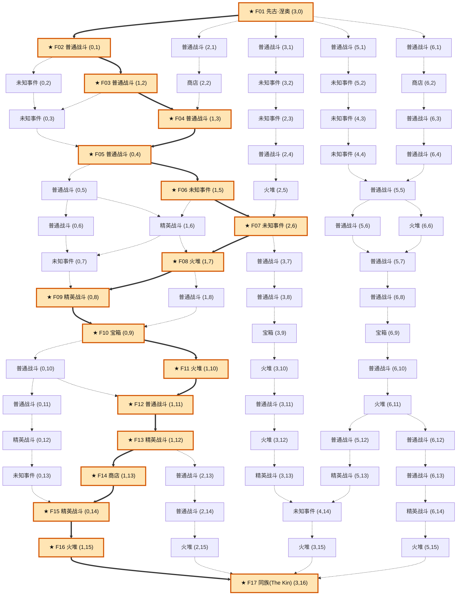
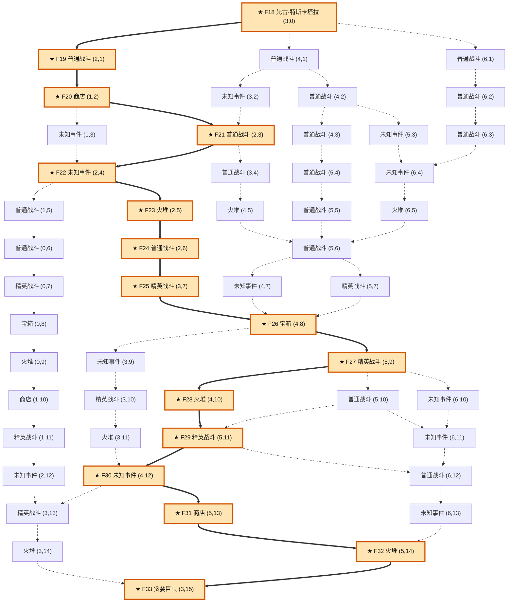
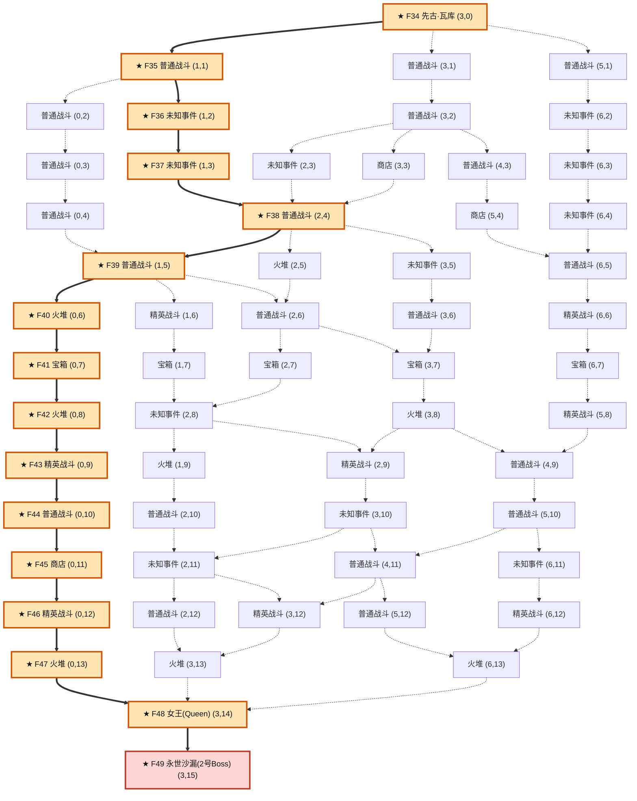

# 《杀戮尖塔 2》愚者（Fool）进阶 10 完整实战技术文档：路线、数值、DPT 与选牌跳过策略

> **文档基准**：基于真实、零求解器、零 SL 实测局 **愚者进阶 10（种子 `E3EQEQ91QFXB`，版本 `v0.113.1`）** 编写，所有路线坐标、卡牌数值、战斗回合数与抓/跳记录均核对自 [02_fool_asc10_E3EQEQ91QFXB.md](../runs/02_fool_asc10_E3EQEQ91QFXB.md)、[steps.jsonl](file:///D:/Antigravity/Projects/sts2_play/current_fool_run/steps.jsonl) 与官方 `.run` 战绩存档 `1795064290.run`。

---

## 一、完整路线规划系统：拓扑图与分叉取舍模型

### 1. 愚者路线评估五维模型

在每幕开始读整张地图时，愚者不能只看“哪里精英多”，而应按以下优先级打分：

1. **前期抓牌密度（Act 1 F02–F05）**：优先连打 `3~4` 场普通战斗快速拿齐第 2 张发射牌与【哇 战锤】/【潜伏根系】联动，避开连续问号空转与早商店。
2. **血线-火堆匹配度（安全阈值）**：打完前置小怪若血量 `< 30%` 且前方无火堆，**坚决避开孤立精英**（本局 F05 剩 `21/77` 血时果断舍弃 `(1,6)` 抢精英）。
3. **启动费遗物 × 商店联动**：获得【烫嘴可可】（T1 +4 费）或【招财异鱼】（加牌 +15G）后，**早商店与后商店的价值瞬间翻倍**；第 3 幕金币 `< 120` 时刻意绕开前 4 层的早商店。
4. **【小邮箱】/【古茶具】“火堆-精英-火堆”夹心收益**：火堆不仅回血/锻造，还能触发【古茶具】（下战 +2 费）与【小邮箱】（送满药水）。有火堆兜底时，前一场精英战可以毫无顾忌地双药水全开换取 `0` 伤。
5. **后期「锻造火堆 + 后期大商店」VS「多一只无商店精英」**：卡组已成形进入第 3 幕后，用 1 只精英换取“2~3 个火堆（修复/升级灵魂金卡）+ 1 个后期大商店（买 Boss 级遗物如【面包】）”通常胜率更高。

---

### 2. 第 1 幕《茂密丛林》完整路线图与分支弃选解析（F01–F17）

**核心分叉弃选原因**：
- **起点 `(3,0)`**：拒走 `(2,1)` / `(6,1)`（第 2 层商店 `99G` 血亏）；拒走 `(3,1)` / `(5,1)`（前段问号过多且整条线只有 `1` 只精英）。选择 `(0,1)→(1,2)→(1,3)→(0,4)` 四连战抢组件并对接左半区 `3` 精英。
- **`F05(0,4)` & `F06(1,5)`**：战后剩 `21/77` 血，避开 `(1,6)` 无火堆裸精英，借 `(1,5)` 附魔 + `(2,6)` 泉水白拿药水 + `(1,7)` 火堆回血，再安全吃下 `(0,8)`、`(1,12)`、`(0,14)` 全部 3 只精英并经 `(1,13)` 商店删【打击】买【叽 跳跃】。

---

### 3. 第 2 幕《巢穴》完整路线图与分支弃选解析（F18–F33）

**核心分叉弃选原因**：
- **起点 `(3,0)`**：手揣 `197G` + 【烫嘴可可】，选 `(2,1)→(1,2)` 抢先逛早商店买第 2 张【曲中意】、第 2 张【叽 跳跃】与第 2 张【叽 长鞭】；放弃 `(4,1)`/`(6,1)` 直到 F31 才见商店的无经济缓线。
- **`F22(2,4)`**：放弃左切 `(1,5)→(0,6)→(0,7)`（被锁进孤立左轨且少火堆串联）；选 `(2,5)` 火堆升级【哇 啾 叽+】后直切中右三精英干线。
- **`F26(4,8)` & `F30(4,12)`**：选 `(5,9)→(4,10)→(5,11)` 构建「精英-火堆-精英」循环；随后携 `222G` 拐进 `(5,13)` 商店买【弹珠袋】+ `(5,14)` 火堆，放弃高风险的 `(3,13)` 第 4 只精英。

---

### 4. 第 3 幕《荣耀》完整路线图与分支弃选解析（F34–F49）

**核心分叉弃选原因**：
- **起点 `(3,0)`**：仅 `84G` 开局，直接避开中/右路过早出现的 `(3,3)`、`(5,4)` 商店，走 `(1,1)` 滚钱与事件。
- **`F39(1,5)` 关键拐点**：放弃中路 `(1,6)` 抢精英（否则后续整条线**彻底没有商店**，攒出的 `270G` 与【招财异鱼】直接作废，且无法先在火堆升回被 F36 镜子降级的【哇 啾 叽】）；选择最左边缘线 `(0,6)→...→(0,13)`，一次性拿到 **3 火堆 + 2 精英 + 270G 后期大商店**（购入【面包】与第 2 张【啾 叽】）。

---

## 二、愚者核心数值计算体系

### 1. 伤害与格挡乘区公式

愚者的爆发来自多乘区精准叠加，出牌前必须按以下公式估算是否够斩/全防：

1. **射击牌伤害公式（受【瞄准】、力量、钢笔尖与易伤加成）**：
   $$\text{射击终伤} = \left\lfloor (\text{基础伤} + \text{力量} + \text{瞄准}) \times M_{\text{状态}} \times M_{\text{钢笔尖}} \right\rfloor$$
   - 本局核心增伤乘区：$M_{\text{易伤}} = 1.5$、$M_{\text{虚弱}} = 0.75$、$M_{\text{钢笔尖}} = 2.0$（第 10 张攻击）。
   - **实战案例（F46 T2）**：基础 `55` 伤的【终曲+】吃到【蹒跚射击】挂上的【易伤】（`1.5×`）并凑齐 `10/10`【钢笔尖】（`2.0×`）：
     $$\text{55} \times 1.5 \times 2.0 \approx 164\text{ 伤（实测单发直接带走 320 血机甲骑士半条命）}$$

2. **【扎穿】触发类攻击公式（核心如【哇 战锤】）**：
   $$\text{哇战锤终伤} = \left\lfloor (\text{基础伤} + \text{力量}) \times 2_{\text{若目标扎穿}} \times M_{\text{状态}} \times M_{\text{钢笔尖}} \right\rfloor$$
   - 若同时命中【扎穿】目标（`2×`）并踩中【钢笔尖】（`2×`），单张 1 费卡直接打出 **`4` 倍**倍率（F29 T2 打出 `36` 伤）。

3. **【拉伸】与多段格挡牌公式（核心如【啾 坚定】、【啾 四肢】）**：
   - 【拉伸】是**作用于你打出的下一张格挡牌的每一次格挡获得动作**并在该牌结算完毕后消耗。
   $$\text{双段格挡牌总盾} = 2 \times \left\lfloor (\text{单段基础盾} + \text{拉伸} + \text{敏捷}) \times M_{\text{脆弱}} \right\rfloor$$
   - **实战验证（F49 T8 复盘核算）**：箭矢在手时【啾 坚定】基础为 `6` 盾两次；手上有 `3` 点【拉伸】时：
     - 单打一次：$(6 + 3) \times 2 = 18$ 盾；
     - 配合【复制药水】复制一次（第 2 次释放不再消耗新【拉伸】）：$18 + (6 \times 2) = 30$ 盾，叠加原本 `11` 盾共 `41` 盾，面对 `51` 总伤仅掉 `10` 血再靠`再生(4)`回到 `15/87` 存活。
   - **【啾 叽】循环技巧**：打出【啾 叽】既获双段旋律又会把刚消耗的【拉伸】还给你，等于免费叠加一次护盾并把【拉伸】转交给下一张【啾 坚定】/【啾 四肢】。

---

### 2. 【曲中意】过牌期望与 10 手牌防爆牌公式

- **触发规则**：
  - 每次获得 **当前尚未激活的新旋律**（哇 / 啾 / 叽 之一），每层【曲中意】抽 `1` 张牌；
  - 一旦三旋律全部点亮，后续再打单音色牌 **不会** 再触发【曲中意】抽牌。
- **手牌上限约束（最大 `10` 张）**：
  $$\text{安全开牌条件}：H_{\text{当前}} - 1 + D_{\text{自带}} + (L_{\text{曲中意}} \times \Delta M_{\text{未亮新旋律}}) \le 10$$
  - 例：场上双【曲中意】（$L=2$），三种旋律全未点亮（$\Delta M=3$），打出自带抽 `2` 张的【哇 啾 叽+】（$D=2$），总抽牌数高达 $2 + 2 \times 3 = 8$ 张！
  - 因此打【哇 啾 叽+】前，手牌数必须先泄到 **$H_{\text{当前}} \le 3$ 张**（优先打掉 0 费【啾 四肢】、【快速射击】、【终曲+】），否则必然爆牌或无法触发后续过牌。

---

### 3. 跨回合能量结转模型（【冰淇淋】+【叽 长鞭】+【叽 休止符】）

令第 $t$ 回合基础能量为 $E_{\text{base}}$，本回合结束时剩余能量为 $E_{\text{rem}}$：
$$E_{t+1} = E_{\text{base}} + E_{\text{rem}} + 2 \times N_{\text{长鞭}} + 3 \times N_{\text{长鞭+}} + 5 \times N_{\text{休止符}} + \Delta_{\text{茶具/灯笼/可可}}$$
- **实战节费原则**：只要敌人当回合“只上 Buff”或“当前护盾已完全挡住来袭伤害（含【凋萎】）”，**绝不为了多打 1 张【防御】浪费 1 费**。留 1 费给下回合，往往能让你下回合多打出一轮【翻找+】或【曲中意】。

---

## 三、回合均伤害（DPT）计算方法与全阶段实测验算

### 1. 理论 DPT 计算公式

对于以「箭矢-旋律循环」为核心的愚者构筑，理论回合均伤害（Damage Per Turn, DPT）定义为：

$$\text{理论 DPT} = \frac{\sum \text{单轮循环有效输出（射击 + 战锤双倍 + 0费终曲+ + AOE）}}{T_{\text{实际循环回合}}} + \text{回合被动/遗物均伤}$$

其中循环周期 $T_{\text{实际循环回合}}$ 受**有效牌库厚度 $N_{\text{有效}}$** 与**单回合有效过牌量 $C_{\text{抽}}$**决定：
$$T_{\text{实际循环回合}} = \frac{N_{\text{总}} - N_{\text{能力已打出}} - N_{\text{消耗}}}{5 + C_{\text{曲中意/跳跃/翻找平均抽牌}}}$$

- **关键修正项（为什么抓牌必须慎之又慎）**：每多塞进 1 张没有过牌也不在关键斩杀轴里的白板卡，$N_{\text{总}}$ 增加 1，会直接拉长 **所有核心金卡（【终曲+】、【哇 啾 叽+】）的上手周期 $T$**，从而摊薄 DPT！

---

### 2. 本局四阶段实测 DPT 对比验算表

以下全部回合数与目标血量均直接提取自 `1795064290.run` 与 `steps.jsonl`（注：带护盾或带多随从战斗按“目标总基础血量 ÷ 回合数”计算**有效本体净 DPT**，护盾与溢出伤害使真实总伤更高）：

| 阶段 / 典型战斗 | 牌库规模与引擎状态 | 实测回合数 / 战损 | 有效本体净 DPT（及关键爆发点） | 诊断结论 |
| --- | --- | --- | --- | --- |
| **Act 1 精英** `F09 异蛙寄生虫` / `F13 旧日雕像` / `F15 多尼斯异鸟` | `15~19` 张，单【曲中意】末期才拿到，主要靠【扎穿】+【哇 战锤】+【钢笔尖】 | `7T`（19伤） / `4T`（8伤） / `2T`（2伤） | 以 `F15` 为例，2 回合总计击杀，T1 单回合即打出 `39`（射击）+`18`（战锤）+ 补刀，**短战爆发超 `35+`/回合** | 循环快、易伤稳，但无【终曲】前缺一锤定音大核 |
| **Act 1 Boss** `F17 同族首领` | `20` 张，T1 药水降 0 费【曲中意】但尚未抓到【终曲】 | `9` 回合，承伤 `47`（`11/77` 险胜） | 主目标【同族神官】`199` 血 + 前排随从分担约 9 回合击杀，神官本体净 DPT ≈ `22.1`（受制于多段防守压力与无大核终结技） | 第 1 幕拿【终曲】前纯靠【扎穿】磨血，DPT 处于及格边缘，靠【固化药水】防住爆发过关 |
| **Act 2 Boss** `F33 贪婪巨虫` | `29` 张，【烫嘴可可】+【古茶具】+【冰淇淋】+ 双【曲中意】+【马萨雷斯的赠礼】 | `6` 回合，承伤 `37`（`50/87`） | 目标 `341` 血 `6` 回合击杀，**实测净 DPT = `56.83`/回合**（T1 打 64、T2 4费终曲打 41、T6 双段哇爆破 `38` 斩杀） | 双引擎与仪式力量启动后，DPT 翻倍以上，轻松碾压第 2 幕 |
| **Act 3 精英** `F46 机甲骑士` | `36` 张但有【宝石面具】+【面包】+【钢笔尖】+ `0` 费【终曲+】 | **`2` 回合**，承伤 `12` | `320` 血 `2` 回合带走，**实测净 DPT ≥ `160.0`/回合**（T2 易伤+钢笔尖单发【终曲+】轰 `164` 伤） | 构筑完全体短局巅峰：单轮过空核心牌即可 2 回合终结精英 |
| **Act 3 Boss #1** `F48 女王` | 同上 + 【历石】（第 7 回合 `52` 伤 AOE） | **`7` 回合**，仅掉 **`1` 血**（`86/87`） | 女王本体 `419` 血 `7` 回合击杀（不含护盾），**实测本体净 DPT ≈ `59.86`/回合**（T1 `82` 伤、T6 `121+` 伤压血、T7 【历石】`52` 斩杀） | 兼顾每回合 25~53 点铁壁防线下的超高有效输出 |
| **Act 3 Boss #2** `F49 永世沙漏` | 面对 `535` 血 + `2` 层人工制品 + 回合护盾 + 【凋萎】干扰 | `8` 回合（遗憾阵亡于 T8） | T1–T8 将 Boss 从 `535` 压至 `268`（含剥护盾及 T7【历石】`52` 伤，实测本体净压血 `267/8 ≈ 33.4`/回合，另有大量护盾抵消） | 前期高血护盾与清【凋萎】占用了输出回合，T9 10 费全开原可一举打穿剩余 268 血 |

---

## 四、选牌与「主动跳过」判定规范

整局 `49` 层共经历 **`28` 次选牌 / 商店 / 事件看牌**，其中在普通战斗、精英、Boss 战后**有多次果断全部跳过**（含 **F24、F33 Boss、F39、F43 精英、F46 精英** 三选一全跳过，以及商店不乱买低质卡）。能否适时“忍住不抓”，直接决定了循环周期 $T$ 是否失控！

### 1. 选牌四步评估流（拿/跳判定树）

每次看到 3 选 1 奖励牌时，按顺序过一遍下面 4 条门禁，**4 条均未给高分就果断点击「跳过」**：

1. **门禁 A：是否命中「红线禁忌卡」？（直接淘汰）**
   - ❌ **毁箭矢卡**：如【寂灭】（F33 Boss 金卡果断跳过）。愚者靠唯一箭矢打【扎穿】、双段【啾 坚定】和回费循环，摧毁箭矢等于自断双臂。
   - ❌ **烧毁关键牌的卡**：如【怒放】（F33 跳过，容易烧掉核心射击/功能牌）。
   - ❌ **无消化手段的【悲伤】制造卡**：如【哀伤打击】、`苦闷`（F03、F19、F27、F35、F37、F43 全程全部跳过）。除非牌组已有【狂喜】或大量消耗位，否则带有「保留」的【悲伤】会永久占掉 10 张手牌中的 1~3 格，直接废掉【哇 啾 叽+】与【翻找+】。
   - ❌ **稀释【宝石面具】池的能力卡**：拿到【宝石面具】后，**拒绝所有非 S 级能力牌**（本局在 F45 商店坚决不买【歌之道】，F46 坚决跳过第 3 张【曲中意】），保证首回合 100% 抽到【曲中意】或〔迅速2〕【潜伏根系】。

2. **门禁 B：当前牌库是否已经超出“单旋律/功能上限”？**
   - 【曲中意】：`2` 张足矣，第 3 张卡手（F21、F46 均主动放弃第 3 张【曲中意】）。
   - 【哇 战锤】 / 【沉重射击】 / 【深度拉伸】：后期已有足够【扎穿】配合与【潜伏根系】时，再拿纯粹的 1 费功能伤害或纯蓄力牌只会让【哇 啾 叽+】沉底（本局后期 `7` 次遇到【深度拉伸】/`哇 战锤`/`沉重射击` 全部跳过）。

3. **门禁 C：有没有直接的“过牌 / 减费 / 零费动作”收益？**
   - 优先抓：**同时带多旋律 + 过牌**（如【哇 啾 叽】、【啾 叽】）、**看牌滤抽**（【叽 唱诵+】、【翻找+】）、**下回合产费**（【叽 长鞭】、【叽 休止符】）、**0 费免费启动【扎穿】**（【快速射击+】）。

4. **门禁 D：经济遗物协同（【招财异鱼】例外加分）**
   - 拿到【招财异鱼】（每加入 1 张牌 +15G）后，**0 费过牌/0 费射击**（如 F29【快速射击+】、F30【快速射击】、F44【叽 唱诵+】）不仅本身不卡费、甚至还能帮你凑整买下【弹珠袋】或【面包】！**但即便有招财异鱼，也绝不为区区 15 金抓一张废牌污染牌库**（F39、F43、F46 依然果断跳过）。

---

### 2. 本局核心跳过案例一览（为什么宁缺毋滥）

| 楼层 | 出现的 3 选 1 候选牌 | 最终决定 | 核心跳过原因 |
| --- | --- | --- | --- |
| **F24** 普通战 | 【说笑】 / 【持弓猛击】 / 【深度拉伸】 | **全部跳过** | 此时已有 2 张【曲中意】与高浓度旋律体系，三张白板非过牌组件只会稀释引擎 |
| **F33** Act 2 Boss | 【怒放】 / 【寂灭】 / 【狂喜】 | **全部跳过** | 【怒放】烧核心功能卡；【寂灭】摧毁唯一箭矢直接瘫痪体系；卡组无【悲伤】使【狂喜】成白板 |
| **F39** 普通战 | 【沉重射击】 / 【大树将倾+】 / 【生长】 | **全部跳过** | 已有 5 张高质量射击牌且【终曲+】是唯一输出核，不补笨重攻击牌 |
| **F43** Act 3 精英 | 【哀伤打击】 / 【持弓猛击】 / 【啾 坚定】 | **全部跳过** | 已有 2 张【啾 坚定】防线完全溢出；【哀伤打击】会制造保留【悲伤】污染 10 张手牌上限 |
| **F46** 决战前精英 | 【绷紧】 / 【曲中意】 / 【啾 四肢】 | **全部跳过** | 绝不拿第 3 张【曲中意】以免在【宝石面具】与多 Boss T1 2 费卡手；已有足够防牌 |

---

## 五、防翻车操作规范（F49 血泪教训清单）

1. **多药水槽位索引绝对校验规则**：
   - 当消耗掉左侧 `slot 0` 的药水（如 T7 喝掉【再生药水】）后，右侧 `slot 1` 的【复制药水】**仍停留在索引 `1`**，游戏 UI 会显示为 `None : 复制药水`。
   - **铁律**：每次执行 `use_potion` 前必须重新读取当前实时药水列表及精确索引；若是自动化批处理脚本，一旦前置的 `use_potion` 返回失败或提示状态不可用，**必须立刻中止后续打牌动作并重算防御，绝不允许跳过药水继续把未翻倍的格挡牌打出去**。
2. **【凋萎】与回合末伤害计入格挡总需求**：
   - 面对【永世沙漏】往牌库塞的【凋萎】（在手里结束回合会造成 `3 / 6 / 9` 点伤害），必须把**“手牌保留未弃掉的【凋萎】总伤害 + 敌方意图攻击伤害”**合并为本回合的最低安全格挡线；当手里【哇/啾】刚好激活时，慎打会**保留全手牌**的【叽 休止符】，防止把几张【凋萎】一起留到下回合持续掉血。
3. **魂缚锁链（女王战）唯一名额分配顺序**：
   - 每回合仅能打出 `1` 张带「魂缚」标记的牌。开局先把非魂缚过牌打完，最后再把唯一的魂缚名额留给【涅奥之怒】、【叽 长鞭+】、【哇 啾 叽+】或 0 费【终曲+】；**绝不随手先打魂缚【打击】或魂缚【防御】锁死全手牌！**
