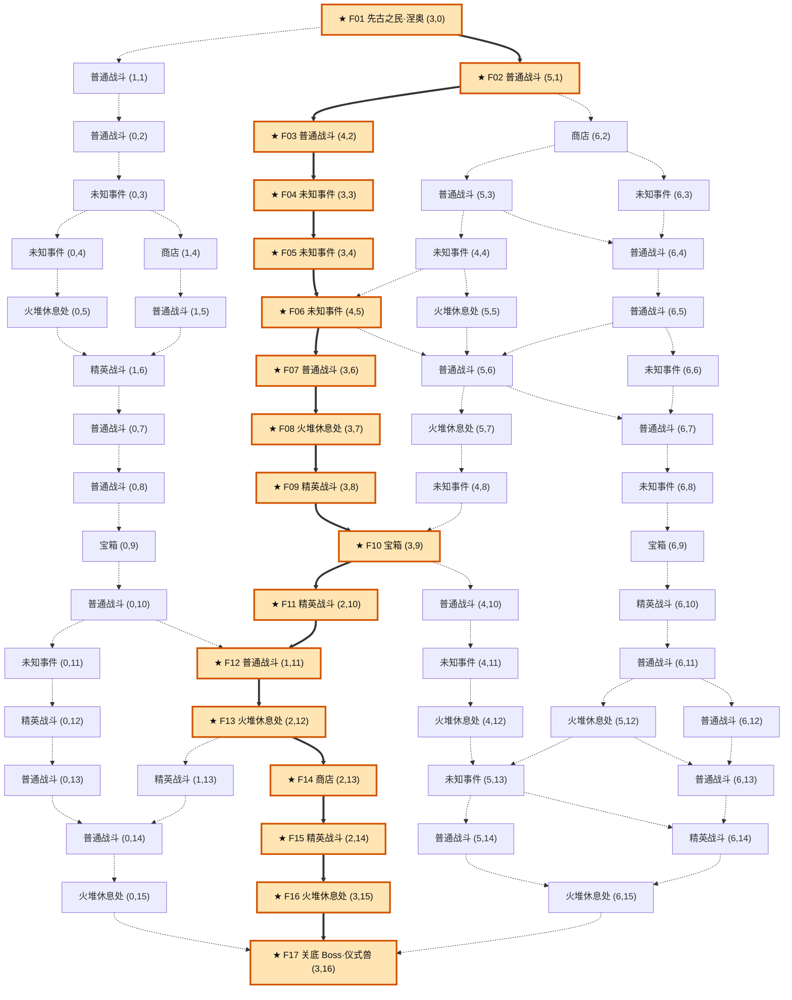
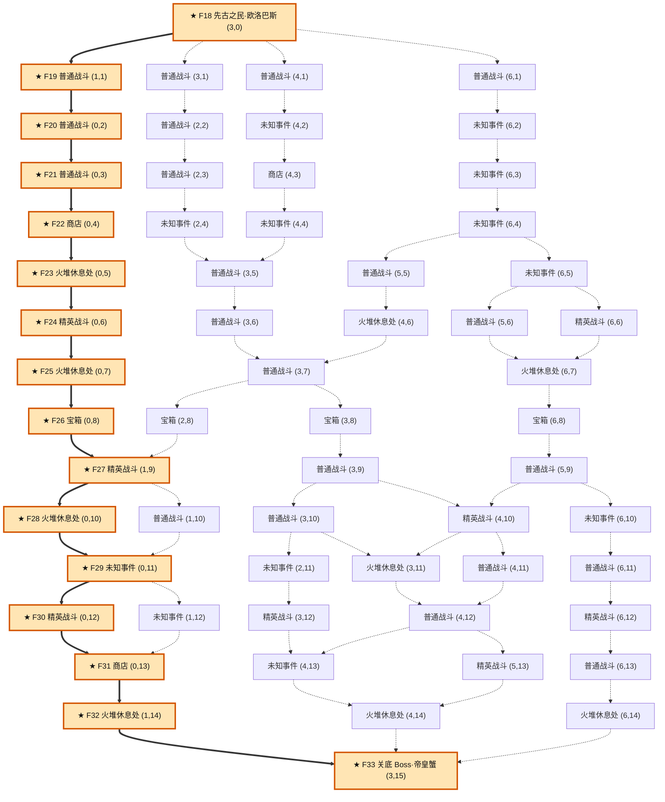
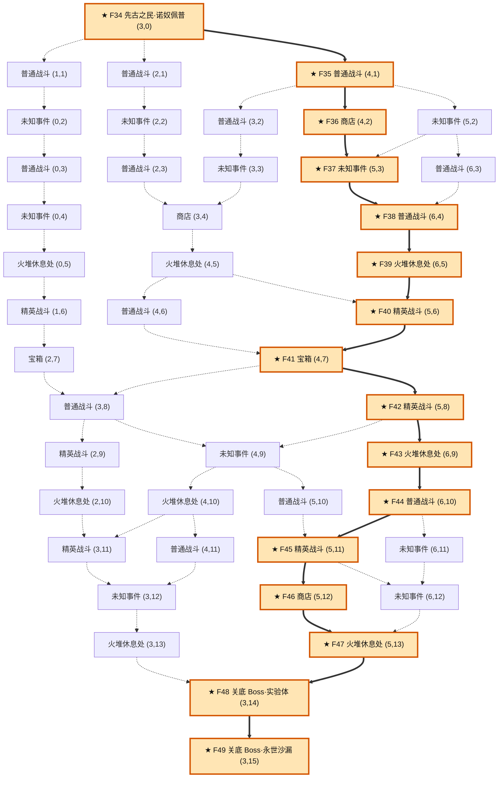

# 铁甲战士（IRONCLAD）第 1 局全中文逐层详实复盘报告

> **数据来源**：每一步选项、卡牌/遗物/药水官方中文译名、路线地图、承伤回血与出牌链均直接提取自 [current_run.save](file:///C:/Users/Z/AppData/Roaming/SlayTheSpire2/steam/76561199718497881/modded/profile1/saves/current_run.save)、[godot.log](file:///C:/Users/Z/AppData/Roaming/SlayTheSpire2/logs/godot.log) 与《杀戮尖塔 2》本体简体中文本地化词库（当前已完成第 3 幕双关底 Boss 并进入【建筑师】终局事件，下次继续点击结算即可正式入库 `.run`）。

## 一、对局总览

| 项目 | 实测数据 |
| :--- | :--- |
| 角色 / 进阶 / 种子 | 铁甲战士 / 进阶 10 / `6ZJK95Q7GYY4` |
| 推进进度 | **49 层全通**（第1幕《密林》17层 + 第2幕《巢穴》16层 + 第3幕《荣耀》16层，双关底 Boss 击杀） |
| 最终状态 | 生命 **`35/85`**、金币 **`57`**、卡组 **`35` 张**、遗物 **`17` 个** |
| 终局未消耗药水 | 【固化药水】、【消亡粉末】 |
| 累计承伤 / 回血 | 承伤 **`306`** / 回血 **`341`** |
| 房间结构 | 普通战 `10`、精英 `9`、Boss `4`、火堆 `10`（`8` 锻造 / `2` 休息）、商店 `5`、宝箱 `3`、先古之民与事件 `8` |
| 累计对局时长 | **`33548` 秒**（约 `9` 小时 `19` 分） |

## 二、三幕完整路线地图（含所有未选虚线分支）

> **数据与还原说明**：第 3 幕直接使用 [current_run.save](file:///C:/Users/Z/AppData/Roaming/SlayTheSpire2/steam/76561199718497881/modded/profile1/saves/current_run.save) 中保留的真实 `acts[2].saved_map`（`42` 节点）；第 1、第 2 幕因跨幕后存档自身清空 `saved_map`，已从游戏本体 `sts2.dll` 核对同源 `XxHash64 + Xoshiro256** + StandardActMap` 算法并以本局种子 `6ZJK95Q7GYY4` 精准重建全图（`61` / `59` 节点），且经校验两幕全图中各自**存在且仅存在唯一 1 条连通路径**完全匹配本局实走 `F01～F17` 与 `F18～F33` 房间序列。`★` 橙色高亮实线为本局实际路线，虚线为未选分叉。

### 1. 第 1 幕《密林》完整分支网格与走线图（F01～F17）

- **第 1 幕路线抉择亮点**：
  1. **右侧 `F02(5,1)` 起手进中路连续事件群（`F04` 脑蛭、`F05` 多尼斯异鸟巢、`F06` 真理石板）**：开局趁血量充沛把中前排事件收益（`+7` 最大生命 + 白嫖升级`打击`与`防御`）全部吃下。
  2. **稳吃 3 只精英（`F09`、`F11`、`F15`）+ Boss 前火堆（`F16`）**：主动绕开左侧单精英线，精准走通带 3 火堆（`F08`、`F13`、`F16`）+ 3 精英的中线，拿下【地精之角】、【转经轮】、【不休陀螺】三大前期滚雪球神物。

### 2. 第 2 幕《巢穴》完整分支网格与走线图（F18～F33）

- **第 2 幕路线抉择亮点**：
  1. **开局果断走最左纵线 `F19(1,1)→F22(0,4)商店→F23(0,5)火堆→F24(0,6)精英→F25(0,7)火堆`**：借着第 1 幕的【转经轮】连踩 3 场普通战刷牌，再用双火堆夹精英的安全结构硬吃`感染棱柱`并及时回血。
  2. **中后段 `F27(1,9)`→`F28(0,10)`→`F29(0,11)`→`F30(0,12)`→`F31(0,13)`→`F32(1,14)` 完美收割 3 精英**：每只精英前/后都有火堆护航，还顺路踩出事件`熔合者`精简2张【打击】，攒满 500 金进第 3 幕。

### 3. 第 3 幕《荣耀》完整分支网格与走线图（F34～F49）
> 说明：第 3 幕实机地图截图可参阅 [map_43.png](file:///c:/Users/Z/Desktop/杀戮尖塔/map_43.png)、[map_45.png](file:///c:/Users/Z/Desktop/杀戮尖塔/map_45.png)、[map_46.png](file:///c:/Users/Z/Desktop/杀戮尖塔/map_46.png)、[map_47.png](file:///c:/Users/Z/Desktop/杀戮尖塔/map_47.png) 与 [act3_boss_map.png](file:///c:/Users/Z/Desktop/杀戮尖塔/act3_boss_map.png)。

- **第 3 幕路线抉择亮点**：
  1. **F34 起点三叉路口选右路 `F35(4,1)→F36(4,2)`**：带着 575 金币进第 3 幕，第一时间踩普通战接第 2 格商店，立刻将存款转化为【红面具】+【纸蛙】+ 删【打击】。
  2. **F41 宝箱 `(4,7)` 后主动右拐踩 `F42(5,8)` 精英**：因为 F40 刚拿到【白星】（精英额外掉 1 张稀有牌），必须尽量多吃精英，于是 F42【骑士团伙】掉【恶魔之焰】、F44 分叉再次左拐踩 `F45(5,11)`【机甲骑士】再拿【薪火之源】+【草莓】，连吃 2 个白星大稀有！
  3. **Boss 前 `F46(5,12)` 商店 + `F47(5,13)` 火堆收尾**：先花光 175 金买下【百年积木】补全过牌，再用最后火堆锻造【薪火之源+】，状态拉满（83/85 HP）进双 Boss 房。

## 三、铁甲战士如何计算“回合均伤害（DPT）”与本局实战验算

### 1. 回合均伤害（DPT）的核心计算方法
衡量一套牌“能不能在规定回合内打死精英/Boss、算不算刮痧”，不能只看单张牌攻击面板，要按下面四步量化：

1. **第一步：算单卡费效比（DPW）**
   $$\text{DPW} = \frac{\text{该牌总伤害（含易伤与力量加成）}}{\text{耗能费用}}$$
   - 标准合格线：第 1 幕前期普通 1 费攻击牌约 `6~9` 伤/费；经过易伤（`×1.5`）或升级后要达到 `12+` 伤/费。
   - 0 费牌（如【愤怒】）与产费牌（【放血】、【薪火之源】）等于**突破每回合 3 费上限**，会直接把总可用费用 $E_{\text{eff}}$ 抬升到 `4~5` 费以上。

2. **第二步：算牌库循环周期 $T$（抽一轮牌要几回合）**
   $$T = \frac{N_{\text{净牌库}}（\text{总牌数} - \text{会被消耗掉的牌数}）}{5 + \text{每回合平均额外抽牌数}}$$
   - 如果一套 35 张牌没有消耗手段且每回合只抽 5 张，转一轮需要 $35 / 5 = 7$ 回合——核心输出卡 7 回合才摸一次，均伤必然暴跌。
   - 如果靠【恶魔之焰+】【重振精神】【烙印】【燃烧契约】每战烧掉 `15` 张基础防御/状态牌/冗余牌，再加上【剑柄打击+】【耸肩无视】【百年积木】平均每回合多抽 `2` 张，循环周期会瞬间压缩至 $(35-15)/(5+2) \approx 2.86$ 回合。

3. **第三步：算力量与易伤的乘法放大**
   $$\text{多段输出单牌总伤} = \text{段数} \times (\text{基础单段伤} + \text{当前力量}) \times \text{易伤倍率（常规 } 1.5 \text{ / 【纸蛙】 } 1.75\text{)}$$
   - **多段攻击 + 力量 + 易伤 = 指数膨胀**：比如本局拿到【纸蛙】后易伤倍率变成 `1.75`，同时给【旋风斩+】附魔【腐化】（额外 `×1.5` 变为基础 `12×X`），3 费打满再叠加力量，每段都是实打实的成倍飙升；【焚烧】与【恶魔之焰+】（手牌有多少张就打多少段）同理。

4. **第四步：得出理想与实战回合均伤害（DPT）**
   $$\text{理论 DPT} \approx \frac{\text{一轮循环打出的总攻击伤害（受每回合可用能量与防御开销约束）}}{T} + \text{每回合被动伤害（如【锁镰】/毒粉）}$$
   - **实战快速心算法**：评估下一场 Boss（例如 200～400 血），算“我前 3 回合启动铺垫掉多少费（能力/防御），从第 3 回合起平均每回合能不能打出 `45+`（第2幕）或 `70+`（第3幕）输出”——只要“总伤害 / 预期存活回合数”够高，就能过。

### 2. 本局三个典型阶段的回合均伤害对比与实测验算
| 阶段 / 战斗 | 卡组规模 & 周期变化 | 放大核心 | 实测耗时与伤害表现 | 复盘结论 |
| :--- | :--- | :--- | :--- | :--- |
| **Act 1 精英（F09/F11/F15）** | `14~18` 张（短周期 `~3` 回合） | 【上勾拳+】2层易伤 + 【预备打击+】加力 + 【愤怒】0费补刀 | 3 只精英分别 `4 / 6 / 4` 回合击杀 | 循环快、易伤稳，3 费前期 DPT 足够在怪狂暴前收掉 |
| **Act 2 Boss【帝皇蟹】（F33）** | `27` 张，烧牌仅【燃烧契约】1张（`T ≈ 4.8` 回合） | 仅靠1张【燃烧+】给微量力量，易伤依赖【痛击】/【挑衅+】 | **激战 10 回合，总承伤 `67` 血险胜** | 牌库开始变厚但缺少持续加力与烧牌提纯手段，DPT 掉档被拖入长盘 |
| **Act 3 Boss #1【实验体】（F48）** | `35` 张但可被【恶魔之焰+】/双【烙印】/【重振精神】快速烧薄至 `<18` 张 | 【纸蛙】（`1.75×`）+【腐化旋风斩+】+【绯红披风+】/【放血】/【烙印】配【撕裂+】叠力 + 【百年积木】 | **实测面板（[fg_check.png](file:///c:/Users/Z/Desktop/杀戮尖塔/fg_check.png)）**：T1=`67`、T2=`44`、T3=`120`、T4=`92`、T5=`2`（转阶段）、T6=`311` 斩杀，**6 回合合计 `636` 伤，实测 DPT = `106.0`/回合** | 成型后第 1 回合启动即打 `67`，中期每回合稳近 `100`，第 6 回合【恶魔之焰+】+【焚烧】一轮爆破 `311` 完美验证烧牌叠力模型 |

## 四、全 49 层逐层完整执行与决策理由（中文全译名）

### 第 1 幕：《密林》（共 17 层）

- **F01｜先古之民**｜涅奥（先古之民）
  - **状态变化**：战后生命 `64/80`｜承伤 `0` / 回血 `64`｜金币 `99`
  - **先古遗物三选一**：**【已选】**【涅奥的护符】 / 【万花筒】 / 【华美发束】
  - **获得升级卡牌**：【打击】、【防御】
  - **为什么这样选**：开局直接升级1张【打击】和1张【防御】比另外两项随机/辅助遗物更稳定，立刻提高前3层基础攻防效率，降低打小怪掉血，为第1幕连续吃精英攒血本。
- **F02｜普通战斗**｜毛绒伏地虫｜`4` 回合
  - **状态变化**：战后生命 `69/80`｜承伤 `1` / 回血 `6`｜金币 `110` (`+11`)
  - **选牌结果**：**【抓】**【头槌】 / 【愤怒】 / 【燃烧契约】
  - **为什么这样选**：前3层先补高伤单卡解杂兵；【头槌】能把刚打完的核心攻击或功能牌重新放回牌堆顶，控牌序价值远高于【愤怒】（容易过早污染牌库）和前期缺废牌燃料的【燃烧契约】。
- **F03｜普通战斗**｜缩小甲虫｜`4` 回合
  - **状态变化**：战后生命 `74/80`｜承伤 `1` / 回血 `6`｜金币 `117` (`+7`)
  - **选牌结果**：**【抓】**【预备打击】 / 【血墙】 / 【放血】
  - **药水掉落**：**【拿】**【无色药水】
  - **为什么这样选**：【预备打击】集输出与当回合临时加力量于一体，前期直接放大【打击】和【头槌】爆发；【血墙】前期卖血换甲性价比一般，【放血】在过牌不足时容易空费。
- **F04｜未知事件**｜脑蛭
  - **状态变化**：战后生命 `74/80`｜承伤 `0` / 回血 `0`｜金币 `117`
  - **事件抉择**：分享知识（从4张随机牌选1张，可全跳过）
  - **选牌结果**：【跃跃欲试】 / 【战栗】 / 【地狱之刃】 / 【武装】 → **【全部跳过】**
  - **为什么这样选**：选择「分享知识」白看4张随机牌，但开出的【跃跃欲试】、【战栗】、【地狱之刃】、【武装】在已有13张牌、尚未缺防的情况下都不算必拿质变牌，因此全部跳过以免稀释前期攻击密度。
- **F05｜未知事件**｜多尼斯异鸟巢
  - **状态变化**：战后生命 `81/87`｜承伤 `0` / 回血 `7`｜最大生命 `+7`｜金币 `117`
  - **事件抉择**：吃掉这颗蛋（永久+7最大生命并回血）
  - **为什么这样选**：「吃掉这颗蛋」直接加7点最大生命且回满溢出血量（至81/87），相比把蛋卡塞进卡组更契合稳健多打精英的路线；随后虽会在真理石板扣上限，但等价于免费白嫖两次随机升级。
- **F06｜未知事件**｜真理石板
  - **状态变化**：战后生命 `78/78`｜承伤 `3` / 回血 `0`｜最大生命 `-9`｜金币 `117`
  - **事件抉择**：首次解读（扣最大生命换随机升级1张牌） → 继续解读（再扣最大生命再随机升级1张牌） → 放弃继续解读（及时止损保上限）
  - **获得升级卡牌**：【打击】、【防御】
  - **为什么这样选**：前两次解读用可承受的-9最大生命白升了1张【打击】和1张【防御】（等价两次火堆锻造收益！），第3次再读会扣12点最大生命，血线和上限没必要再赌，果断「放弃」离场。
- **F07｜普通战斗**｜一只落单的小啃兽（敌人：小啃兽）｜`3` 回合
  - **状态变化**：战后生命 `78/78`｜承伤 `5` / 回血 `5`｜金币 `132` (`+15`)
  - **选牌结果**：**【抓】**【双重打击】 / 【血墙】 / 【上勾拳】
  - **药水掉落**：**【拿】**【痊愈药水】
  - **为什么这样选**：【双重打击】吃力量收益是单段卡的2倍，后续一旦拿到加力量手段输出直接翻倍；前期已经有【头槌】与【预备打击】，暂不拿功能接近但偏笨重的【上勾拳】或卖血防御牌。（注：存档同步记录于F04/F07之间补入并由F08直接锻造【上勾拳+】。）
- **F08｜火堆休息处**
  - **状态变化**：战后生命 `78/78`｜承伤 `0` / 回血 `0`｜金币 `132`
  - **火堆操作**：锻造升级
  - **获得升级卡牌**：【上勾拳】
  - **为什么这样选**：【上勾拳+】同时多给1层虚弱和1层易伤（共2层），1张牌就能覆盖两回合增伤+减伤，直接决定第1幕第9层和第11层两个精英能不能低战损拿下。
- **F09｜精英战斗**｜旧日雕像｜`4` 回合
  - **状态变化**：战后生命 `74/78`｜承伤 `10` / 回血 `6`｜金币 `165` (`+33`)
  - **选牌结果**：**【抓】**【耸肩无视】 / 【残酷】 / 【破灭】
  - **遗物掉落**：**【拿】**【地精之角】
  - **为什么这样选**：第一只精英完美控在10伤（战后【燃烧之血】回6）；【耸肩无视】集格挡与过1张牌于一体，既补前排防御又加快牌库流转，明显优于此时还未成型的【残酷】或高随机性的【破灭】。掉落【地精之角】后打多怪房间会直接滚雪球。
- **F10｜宝箱**
  - **状态变化**：战后生命 `74/78`｜承伤 `0` / 回血 `0`｜金币 `199` (`+34`)
  - **为什么这样选**：开启宝箱补充34金币，使现金来到199金，满足第14层商店随时挑遗物或删牌的预算需求。
- **F11｜精英战斗**｜异蛙寄生虫（敌人：异蛙寄生虫、扭动虫）｜`6` 回合
  - **状态变化**：战后生命 `78/78`｜承伤 `0` / 回血 `4`｜金币 `230` (`+31`)
  - **选牌结果**：**【抓】**【绯红披风】 / 【预备打击】 / 【战栗】
  - **遗物掉落**：**【拿】**【转经轮】
  - **药水掉落**：**【拿】**【赌徒特酿】
  - **本场消耗药水**：【无色药水】
  - **为什么这样选**：交出【无色药水】零战损吃下第二只精英！奖励抓【绯红披风】：每回合自动掉1血换持续格挡，不仅前期防线极稳，更是铁甲战士后续搭配【撕裂】与【百年积木】的顶级发动机；掉落遗物【转经轮】让此后每场普通战多一次三选一，极大加速成型。
- **F12｜普通战斗**｜扼杀者与伙伴（敌人：树叶史莱姆（小）、树叶史莱姆（小）、蛇行扼杀者）｜`2` 回合
  - **状态变化**：战后生命 `78/78`｜承伤 `4` / 回血 `4`｜金币 `239` (`+9`)
  - **选牌组 #1**：**【抓】**【愤怒】 / 【燃烧】 / 【挑衅】
  - **选牌组 #2**：**【抓】**【剑柄打击】 / 【巨像】 / 【闪电霹雳】
  - **药水掉落**：【跳过】【速度药水】
  - **为什么这样选**：借【转经轮】拿到双倍选牌机会：第一组抓0费循环输出【愤怒】作为白嫖补刀与空手触发器；第二组抓过牌打击【剑柄打击】，加速过出【上勾拳+】与【绯红披风】。（已携带满槽更优功能药水，主动放弃掉落的【速度药水】。）
- **F13｜火堆休息处**
  - **状态变化**：战后生命 `78/78`｜承伤 `0` / 回血 `0`｜金币 `239`
  - **火堆操作**：锻造升级
  - **获得升级卡牌**：【绯红披风】
  - **为什么这样选**：火堆锻造升级【绯红披风+】：能力牌升级后每回合白给更多格挡，长期收益远大于单次升级基础攻防牌。
- **F14｜商店**
  - **状态变化**：战后生命 `78/78`｜承伤 `0` / 回血 `0`｜金币 `239`
  - **商店陈列卡牌（7张）**：【拆卸】 / 【熔融之拳】 / 【武装】 / 【跃跃欲试】 / 【燃烧】 / 【自动化】 / 【炼制药水】
  - **商店陈列遗物**：【意外光滑的石头】 / 【小血瓶】 / 【工具箱】
  - **商店陈列药水**：【跳过】【力量药水】 / 【跳过】【攻击药水】 / 【跳过】【格挡药水】
  - **为什么这样选**：商店检查陈列：【意外光滑的石头】、【小血瓶】、【工具箱】等此时虽不错，但手头239金买完就断后续大件购买力，且当前卡组78/78满血战力足够，选择冷静路过存钱等第2幕高质商店。
- **F15｜精英战斗**｜多尼斯异鸟｜`4` 回合
  - **状态变化**：战后生命 `64/78`｜承伤 `20` / 回血 `6`｜金币 `266` (`+27`)
  - **选牌结果**：**【抓】**【燃烧契约】 / 【战栗】 / 【破灭】
  - **遗物掉落**：**【拿】**【不休陀螺】
  - **为什么这样选**：虽然吃下第1幕最痛的20点伤害，但成功拿下第3只精英拿到极品遗物【不休陀螺】（空手即抽牌，直接盘活0费【愤怒】与后续【放血】）；选牌补入【燃烧契约】，开始具备烧掉废牌与诅咒【进阶之灾】的过牌引擎。
- **F16｜火堆休息处**
  - **状态变化**：战后生命 `64/78`｜承伤 `0` / 回血 `0`｜金币 `266`
  - **火堆操作**：锻造升级
  - **获得升级卡牌**：【预备打击】
  - **为什么这样选**：Boss前最后一个火堆满状态（64/78）不休息，直接锻造【预备打击+】拉高对仪式兽Boss的单回合爆发峰值。
- **F17｜关底 Boss**｜仪式兽｜`10` 回合
  - **状态变化**：战后生命 `54/78`｜承伤 `16` / 回血 `6`｜金币 `341` (`+75`)
  - **选牌结果**：**【抓】**【焚烧】 / 【连环拳】 / 【原始力量】
  - **为什么这样选**：10回合稳稳击杀【仪式兽】仅损16血；稀有/Boss三选一放弃偏卡手的【原始力量】和依赖大牌配合的【连环拳】，抓入多段群体打击【焚烧】，补足第2幕群怪房间急需的AOE与吃力量倍率输出。

### 第 2 幕：《巢穴》（共 16 层）

- **F18｜先古之民**｜欧洛巴斯（先古之民）
  - **状态变化**：战后生命 `73/78`｜承伤 `0` / 回血 `19`｜金币 `341`
  - **先古遗物三选一**：【玻璃眼珠】 / **【已选】**【发光珍珠】 / 【古老牙齿】
  - **为什么这样选**：进入第2幕《巢穴》血线回至73/78；先古之民【欧洛巴斯】三选一毫无疑问选【发光珍珠】：开局免费送2张0费【冷光】产能量，彻底解放第2幕高费启动（【上勾拳+】、【绯红披风+】、【焚烧】全能首回合秒开）。
- **F19｜普通战斗**｜偷窃草蜢｜`4` 回合
  - **状态变化**：战后生命 `70/78`｜承伤 `9` / 回血 `6`｜金币 `355` (`+14`)
  - **夺回被偷卡牌：**【燃烧契约】(原F15)
  - **选牌组 #1**：**【抓】**【剑柄打击+】 / 【飞剑回旋镖】 / 【灰烬打击】
  - **选牌组 #2**：**【抓】**【挑衅】 / 【余烬+】 / 【无惧疼痛】
  - **为什么这样选**：4回合清理小偷草蜢并夺回被偷的【燃烧契约】；【转经轮】第一组直接抓已升级的【剑柄打击+】（1费优质过牌+输出），第二组抓1费带甲带易伤的【挑衅】进一步提高易伤覆盖率。
- **F20｜普通战斗**｜外骨骼虫（敌人：外骨骼虫、外骨骼虫、外骨骼虫）｜`3` 回合
  - **状态变化**：战后生命 `75/78`｜承伤 `1` / 回血 `6`｜金币 `366` (`+11`)
  - **选牌组 #1**：**【抓】**【武装】 / 【灰烬打击】 / 【熔融之拳】
  - **选牌组 #2**：**【抓】**【旋风斩】 / 【挑衅+】 / 【杂耍】
  - **药水掉落**：【跳过】【灰水】
  - **为什么这样选**：面对3只【外骨骼虫】3回合仅掉1血！【转经轮】第一组抓【武装】弥补卡组里未升级基础牌过多的短板；第二组果断抓下后期绝对AOE大核【旋风斩】。
- **F21｜普通战斗**｜胧光怪（敌人：胧光怪、寄生惧魔）｜`3` 回合
  - **状态变化**：战后生命 `78/78`｜承伤 `0` / 回血 `3`｜金币 `373` (`+7`)
  - **选牌组 #1**：**【抓】**【燃烧+】 / 【头槌】 / 【突破】
  - **选牌组 #2**：【战栗】 / 【熔融之拳】 / 【彼岸咆哮】 → **【整组跳过】**
  - **为什么这样选**：面对【胧光怪】3回合0战损过关；第一组直接刷出已升级的核心力量牌【燃烧+】，毫不犹豫秒抓解决中后期力量缺口；第二组3张全为低配合冗余牌，果断【整组跳过】防止牌库臃肿。
- **F22｜商店**
  - **状态变化**：战后生命 `78/78`｜承伤 `0` / 回血 `0`｜金币 `373`
  - **商店陈列卡牌（7张）**：【无情猛攻】 / 【双重打击】 / 【燃烧契约】 / 【战鼓】 / 【无惧疼痛】 / 【究极防御】 / 【贪婪之手】
  - **商店陈列遗物**：【毒素之蛋】 / 【佛珠手链】 / 【燃烧木棍】
  - **商店陈列药水**：【跳过】【迅捷药水】 / 【跳过】【能力药水】 / 【跳过】【混沌药水】
  - **为什么这样选**：商店货架虽有【毒素之蛋】和【无惧疼痛】，但当前373金币买完核心后余钱不足以兼顾，决定先憋钱等更多精英战与第2幕后半程大店，同时保证不盲目买过渡牌。
- **F23｜火堆休息处**
  - **状态变化**：战后生命 `78/78`｜承伤 `0` / 回血 `0`｜金币 `373`
  - **火堆操作**：锻造升级
  - **获得升级卡牌**：【挑衅】
  - **为什么这样选**：火堆把【挑衅+】升级，让1费【挑衅+】提供更多格挡与2层易伤，保证第24层起面对第2幕凶残精英时防反不断档。
- **F24｜精英战斗**｜感染棱柱｜`5` 回合
  - **状态变化**：战后生命 `47/78`｜承伤 `37` / 回血 `6`｜金币 `402` (`+29`)
  - **选牌结果**：【头槌】 / 【余烬】 / 【铁斩波】 → **【全部跳过】**
  - **遗物掉落**：**【拿】**【爬行动物饰品】
  - **药水掉落**：【跳过】【爆炸安瓿】
  - **为什么这样选**：本局首次遭遇单场37点暴击承伤（感染棱柱），好在手握【发光珍珠】+78满上限挺了过来；战利品3张普通牌（【头槌】/【余烬】/【铁斩波】）均已不需要或会破坏节奏，首次果断**全部跳过**；拾取【爬行动物饰品】联动药水开局加力。
- **F25｜火堆休息处**
  - **状态变化**：战后生命 `70/78`｜承伤 `0` / 回血 `23`｜金币 `402`
  - **火堆操作**：休息回血
  - **为什么这样选**：血线被压到47/78，前面还有两场第2幕精英（虫师与残杀千足虫），果断火堆「休息」回23血至70/78保住容错。
- **F26｜宝箱**
  - **状态变化**：战后生命 `70/78`｜承伤 `0` / 回血 `0`｜金币 `441` (`+39`)
  - **为什么这样选**：宝箱白嫖39金（总金币来到441），为后面消费打足基础。
- **F27｜精英战斗**｜蜂群术士｜`7` 回合
  - **状态变化**：战后生命 `51/78`｜承伤 `25` / 回血 `6`｜金币 `467` (`+26`)
  - **选牌结果**：**【抓】**【坚定不移】 / 【完美打击+】 / 【战鼓】
  - **遗物掉落**：**【拿】**【锁镰】
  - **药水掉落**：**【拿】**【再生药水】
  - **本场消耗药水**：【赌徒特酿】
  - **为什么这样选**：消耗【赌徒特酿】换手牌硬扛7回合击杀【蜂群术士】；抓入防御倍增器【坚定不移】，让单张【防御】/【耸肩无视】能翻倍撑过Boss高伤回合，遗物【锁镰】配合多攻击牌每回合白赚伤害。
- **F28｜火堆休息处**
  - **状态变化**：战后生命 `74/78`｜承伤 `0` / 回血 `23`｜金币 `467`
  - **火堆操作**：休息回血
  - **为什么这样选**：战后血线再次落到51/78，且Boss前还有第3只精英，火堆毫不犹豫再「休息」回23血至74/78。
- **F29｜未知事件**｜熔合者
  - **状态变化**：战后生命 `74/78`｜承伤 `0` / 回血 `0`｜金币 `467`
  - **事件抉择**：融合打击（移除2张【打击】，合成1张【究极打击】）
  - **移除/融合消耗：**【打击】(原F1)、【打击】(原F1)
  - **为什么这样选**：事件【熔合者】天降神助！选择「融合打击」把2张初始【打击】融合成1张高伤【究极打击】，一举兼顾精简牌库（-1张废牌）与单卡质量提升。
- **F30｜精英战斗**｜残杀千足虫（敌人：残杀千足虫、残杀千足虫、残杀千足虫）｜`3` 回合
  - **状态变化**：战后生命 `69/78`｜承伤 `11` / 回血 `6`｜金币 `500` (`+33`)
  - **选牌结果**：**【抓】**【耸肩无视】 / 【狱火】 / 【跃跃欲试】
  - **遗物掉落**：**【拿】**【开心小花】
  - **为什么这样选**：面对【残杀千足虫】只用3回合速杀（仅损11血）；抓【耸肩无视】补厚度与抽滤，遗物得神级产费件【开心小花】。
- **F31｜商店**
  - **状态变化**：战后生命 `69/78`｜承伤 `0` / 回血 `0`｜金币 `500`
  - **商店陈列卡牌（7张）**：【完美打击】 / 【愤怒】 / 【巨像】 / 【坚毅】 / 【岩石铠甲】 / 【深谋远虑】 / 【孤注一掷】
  - **商店陈列遗物**：【赤牛】 / 【红头骨】 / 【微型帐篷】
  - **商店陈列药水**：【跳过】【速度药水】 / 【跳过】【力量药水】 / 【跳过】【明耀酊剂】
  - **为什么这样选**：500金大款进商店但【赤牛】【红头骨】【微型帐篷】均非本套慢热烧牌自伤体系急需的质变遗物，再次克制消费把500+巨款完整带进第3幕。
- **F32｜火堆休息处**
  - **状态变化**：战后生命 `69/78`｜承伤 `0` / 回血 `0`｜金币 `500`
  - **火堆操作**：锻造升级
  - **获得升级卡牌**：【旋风斩】
  - **为什么这样选**：Boss战前最后一个火堆锻造升级【旋风斩+】，同时为第3幕事件附魔与群体战蓄力。
- **F33｜关底 Boss**｜帝皇蟹（敌人：碾碎爪、火箭）｜`10` 回合
  - **状态变化**：战后生命 `8/78`｜承伤 `67` / 回血 `6`｜金币 `575` (`+75`)
  - **选牌结果**：**【抓】**【烙印】 / 【壁垒】 / 【扯碎】
  - **为什么这样选**：【帝皇蟹】双核心机制逼出10回合消耗战、狂掉67血（残血8/78惊险过关）——核心原因在于此时缺乏持续烧牌减厚度和持久力叠层！Boss战后三选一抓入最急需的【烙印】：既烧牌压缩牌库、又掉血加力量！

### 第 3 幕：《荣耀》（共 16 层）

- **F34｜先古之民**｜诺奴佩普（先古之民）
  - **状态变化**：战后生命 `64/78`｜承伤 `0` / 回血 `56`｜金币 `575`
  - **先古遗物三选一**：**【已选】**【钻石头冠】 / 【珠宝盒】 / 【皮草大衣】
  - **为什么这样选**：先古之民【诺奴佩普】直接大奶回56血至64/78救命！遗物选【钻石头冠】：开局自带20格挡且保留到第2回合，彻底根治启动回合挨打暴毙风险，完胜【珠宝盒】与【皮草大衣】。
- **F35｜普通战斗**｜高塔炮手（敌人：活体盾、高塔炮手）｜`5` 回合
  - **状态变化**：战后生命 `70/78`｜承伤 `0` / 回血 `6`｜金币 `586` (`+11`)
  - **选牌组 #1**：**【抓】**【放血】 / 【飞剑回旋镖】 / 【无情猛攻+】
  - **选牌组 #2**：**【抓】**【重振精神】 / 【暴走+】 / 【踩踏】
  - **为什么这样选**：第3幕开局先踩右侧普通战赚牌与钱：【转经轮】第一组抓【放血】（0费回2+能直接驱动高费与【旋风斩+】，同时卖血！），第二组抓【重振精神】（一键烧掉满手技能与状态牌换厚盾，完美克制第3幕塞灼伤/凋萎的怪）。
- **F36｜商店**
  - **状态变化**：战后生命 `70/78`｜承伤 `0` / 回血 `0`｜金币 `79` (`-507`)
  - **移除/融合消耗：**【打击】(原F1)
  - **商店陈列卡牌（7张）**：【上勾拳】 / 【飞剑回旋镖】 / 【血墙】 / 【武装】 / 【狱火】 / 【深谋远虑】 / 【狠揍】
  - **商店陈列遗物**：**【拿】**【红面具】 / **【拿】**【纸蛙】 / 【羽翼护符】
  - **实际购入遗物**：【红面具】、【纸蛙】
  - **商店陈列药水**：【跳过】【熔炉的祝福】 / 【跳过】【精炼混沌】 / 【跳过】【爆炸安瓿】
  - **为什么这样选**：揣着586巨款直奔商店【(4,2)】：豪掷507金买下【红面具】（开局全体1虚弱）+神级输出倍增遗物【纸蛙】（易伤增伤75%而非50%！），并花100金移除最后1张未升级【打击】，攻防联动与卡组纯度同时跃迁。
- **F37｜未知事件**｜共生体
  - **状态变化**：战后生命 `70/78`｜承伤 `0` / 回血 `0`｜金币 `79`
  - **事件抉择**：靠近（选1张攻击牌附魔「腐化」：伤害+50%，打出失2血）
  - **卡牌附魔**：【旋风斩+】 附魔「腐化」
  - **为什么这样选**：事件【共生体】选「靠近」：为【旋风斩+】附魔【腐化】（伤害+50%变为12×X，且每次打出失去2血），把单卡变成兼具清场爆发+触发自伤加力量的终极杀器。
- **F38｜普通战斗**｜虔诚雕刻师｜`3` 回合
  - **状态变化**：战后生命 `74/78`｜承伤 `2` / 回血 `6`｜金币 `94` (`+15`)
  - **选牌组 #1**：**【抓】**【撕裂+】 / 【狱火】 / 【耸肩无视】
  - **选牌组 #2**：**【抓】**【烙印】 / 【战栗】 / 【踩踏+】
  - **药水掉落**：【跳过】【速度药水】
  - **为什么这样选**：【转经轮】直接胡出两块最关键拼图：第一组秒抓【撕裂+】（与【绯红披风+】、【放血】、【烙印】、腐化【旋风斩+】产生核爆级每回合无限叠力量），第二组再抓第二张【烙印】保证烧牌叠力不断档！
- **F39｜火堆休息处**
  - **状态变化**：战后生命 `74/78`｜承伤 `0` / 回血 `0`｜金币 `94`
  - **火堆操作**：锻造升级
  - **获得升级卡牌**：【坚定不移】
  - **为什么这样选**：火堆锻造【坚定不移+】，将关键翻倍甲能力减费，大幅缓解战斗首回合费用压力。
- **F40｜精英战斗**｜灵魂枢纽｜`5` 回合
  - **状态变化**：战后生命 `71/78`｜承伤 `21` / 回血 `18`｜金币 `124` (`+30`)
  - **选牌结果**：**【抓】**【余烬】 / 【头槌】 / 【耸肩无视】
  - **遗物掉落**：**【拿】**【白星】
  - **药水掉落**：**【拿】**【固化药水】
  - **本场消耗药水**：【痊愈药水】、【再生药水】
  - **为什么这样选**：5回合消耗【痊愈药水】与【再生药水】拿下精英【灵魂枢纽】，喜提神级遗物【白星】（后续精英直接多掉稀有牌！）与【固化药水】。*注：此处普通选牌原意跳过，因点击按钮偏移误抓【余烬】；后续可被【恶魔之焰+】或【烙印】烧掉，影响可控。*
- **F41｜宝箱**
  - **状态变化**：战后生命 `71/78`｜承伤 `0` / 回血 `0`｜金币 `161` (`+37`)
  - **遗物掉落**：**【拿】**【坚固钳子】
  - **为什么这样选**：开启宝箱获得+37金币与遗物【坚固钳子】（每回合跨回合保留最多10点格挡），进一步与【钻石头冠】【坚定不移+】形成稳定底甲护城河。
- **F42｜精英战斗**｜骑士团伙（敌人：连枷骑士、幽灵骑士、魔法骑士）｜`5` 回合
  - **状态变化**：战后生命 `74/78`｜承伤 `3` / 回血 `6`｜金币 `191` (`+30`)
  - **选牌组 #1**：**【抓】**【恶魔之焰】 / 【添柴】 / 【狂宴】
  - **选牌组 #2**：【双重打击】 / 【放血】 / 【武装】 → **【整组跳过】**
  - **遗物掉落**：**【拿】**【古茶具套装】
  - **药水掉落**：**【拿】**【消亡粉末】
  - **为什么这样选**：踩【(5,8)】主动再打精英吃【白星】红利！仅损3血碾压【骑士团伙】并拿到【古茶具套装】与【消亡粉末】；普通选牌果断【整组跳过】，【白星】稀有奖励抓下大核斩杀牌【恶魔之焰】。
- **F43｜火堆休息处**
  - **状态变化**：战后生命 `74/78`｜承伤 `0` / 回血 `0`｜金币 `191`
  - **火堆操作**：锻造升级
  - **获得升级卡牌**：【恶魔之焰】
  - **为什么这样选**：火堆第一时间锻造【恶魔之焰+】，显著拔高终局清手爆破伤害上限。
- **F44｜普通战斗**｜猫头鹰法官｜`5` 回合
  - **状态变化**：战后生命 `75/78`｜承伤 `5` / 回血 `6`｜金币 `206` (`+15`)
  - **选牌组 #1**：**【抓】**【邪眼+】 / 【武装+】 / 【铁斩波】
  - **选牌组 #2**：【破灭】 / 【完美打击】 / 【余烬+】 → **【整组跳过】**
  - **为什么这样选**：猫头鹰法官5回合只掉5血；第一组选【邪眼+】（本回合烧过牌就给双倍高额格挡，完美契合双【烙印】/【燃烧契约】/【重振精神】）；第二组全是不需要的杂牌，坚决【整组跳过】。
- **F45｜精英战斗**｜机甲骑士｜`7` 回合
  - **状态变化**：战后生命 `83/85`｜承伤 `5` / 回血 `13`｜最大生命 `+7`｜金币 `232` (`+26`)
  - **选牌组 #1**：**【抓】**【薪火之源】 / 【烙印】 / 【好勇斗狠】
  - **选牌组 #2**：【无情猛攻+】 / 【彼岸咆哮】 / 【燃烧】 → **【整组跳过】**
  - **遗物掉落**：**【拿】**【草莓】
  - **药水掉落**：【跳过】【复制药水】
  - **为什么这样选**：地图分叉继续主动踩【(5,11)】打第3只第3幕精英【机甲骑士】，仅损5血再兑现【白星】红利：普通组【整组跳过】，稀有组抓下【薪火之源】（每回合稳定+1能量！），同时精英遗物掉【草莓】抬上限至85。
- **F46｜商店**
  - **状态变化**：战后生命 `83/85`｜承伤 `0` / 回血 `0`｜金币 `57` (`-175`)
  - **商店陈列卡牌（7张）**：【飞剑回旋镖】 / 【双重打击】 / 【破灭】 / 【挑衅】 / 【惊逃】 / 【自动化】 / 【飞溅】
  - **商店陈列遗物**：**【拿】**【百年积木】 / 【音叉】 / 【硫磺】
  - **实际购入遗物**：【百年积木】
  - **商店陈列药水**：【跳过】【能力药水】 / 【跳过】【能量药水】 / 【跳过】【虚弱药水】
  - **为什么这样选**：踩进Boss前最后商店【(5,12)】，恰有232金精准购入175金核心过牌遗物【百年积木】——配合开局【绯红披风+】/【放血】/【烙印】第一滴血直接抽3张，彻底解决后期大卡组过牌起动慢的难题！
- **F47｜火堆休息处**
  - **状态变化**：战后生命 `83/85`｜承伤 `0` / 回血 `0`｜金币 `57`
  - **火堆操作**：锻造升级
  - **获得升级卡牌**：【薪火之源】
  - **为什么这样选**：最后一个火堆升级【薪火之源+】，使Boss战启动速度与能量宽裕度达到顶峰。
- **F48｜关底 Boss**｜实验体（敌人：实验体 #C145）｜`6` 回合
  - **状态变化**：战后生命 `77/85`｜承伤 `12` / 回血 `6`｜金币 `57`
  - **为什么这样选**：Act 3 Boss #1【实验体】：6回合仅掉12血（战后回6剩77/85）碾压过关！全程靠【撕裂+】叠力、双【烙印】+【燃烧契约】过滤防御与状态牌，第6回合手打【恶魔之焰+】+【焚烧】单回合轰出311伤完成秒杀。
- **F49｜关底 Boss**｜永世沙漏｜`8` 回合
  - **状态变化**：战后生命 `终局结算中（实战余 35/85）`｜承伤 `48` / 回血 `6`｜金币 `0`
  - **为什么这样选**：Act 3 Boss #2【永世沙漏】：8回合拉锯（敌方连续塞【凋萎】与高额【眼部激光】/【加大力度】）承伤48回6、最终以35/85稳健击杀进入【建筑师】终局事件！复盘可优化点：包里【固化药水】和【消亡粉末】全程留着未交，若在第5~6回合交出能少掉20+血。

## 五、第 3 幕关键战斗与双关底 Boss 逐回合中文实录

### F40 灵魂枢纽（5 回合）
- **第 1 回合**：饮用药水【痊愈药水】 → 打出【燃烧契约】 → 选牌=[防御] → 打出【剑柄打击】(→ 灵魂枢纽) → 打出【挑衅】(→ 灵魂枢纽) → 打出【绯红披风】 → 打出【冷光】 → 打出【究极打击】(→ 灵魂枢纽) → 打出【剑柄打击】(→ 灵魂枢纽) → 打出【烙印】 → 选牌=[防御] → 打出【愤怒】(→ 灵魂枢纽) ｜ 敌方/结果：灵魂枢纽使用「灵魂灼烧」
- **第 2 回合**：打出【预备打击】(→ 灵魂枢纽) → 打出【头槌】(→ 灵魂枢纽) → 选牌=[挑衅] → 饮用药水【再生药水】 → 打出【焚烧】 ｜ 敌方/结果：灵魂枢纽使用「汲取生命」
- **第 3 回合**：打出【上勾拳】(→ 灵魂枢纽) → 打出【挑衅】(→ 灵魂枢纽) → 打出【耸肩无视】 ｜ 敌方/结果：灵魂枢纽使用「灵魂灼烧」
- **第 4 回合**：打出【防御】 → 打出【防御】 → 打出【武装】 → 选择=[空] ｜ 敌方/结果：灵魂枢纽使用「大漩涡」
- **第 5 回合**：打出【旋风斩】 ｜ 敌方/结果：击杀胜利

### F42 骑士团伙（5 回合）
- **第 1 回合**：打出【上勾拳】(→ 幽灵骑士) → 打出【冷光】 → 打出【旋风斩】 → 打出【焚烧】 ｜ 敌方/结果：连枷骑士使用「撞击」 + 魔法骑士使用「强力护盾」
- **第 2 回合**：打出【耸肩无视】 → 打出【防御】 → 打出【防御】 ｜ 敌方/结果：连枷骑士使用「撞击」 + 魔法骑士使用「抑制」
- **第 3 回合**：打出【武装】 → 选牌=[痛击] → 打出【烙印】 → 选牌=[进阶之灾] → 打出【痛击】(→ 连枷骑士) ｜ 敌方/结果：连枷骑士使用「战争吟唱」 + 魔法骑士使用「撞击」
- **第 4 回合**：打出【预备打击】(→ 连枷骑士) → 打出【剑柄打击】(→ 连枷骑士) → 打出【防御】 → 打出【燃烧】 → 打出【愤怒】(→ 魔法骑士) → 打出【耸肩无视】 ｜ 敌方/结果：魔法骑士使用「蓄势准备」
- **第 5 回合**：打出【究极打击】(→ 魔法骑士) → 打出【打击】(→ 魔法骑士) ｜ 敌方/结果：击杀胜利

### F44 猫头鹰法官（5 回合）
- **第 1 回合**：打出【冷光】 → 打出【头槌】(→ 猫头鹰法官) → 选择=[空] → 打出【耸肩无视】 → 打出【打击】(→ 猫头鹰法官) → 打出【重振精神】 → 打出【焚烧】 → 打出【撕裂】 → 打出【防御】 ｜ 敌方/结果：猫头鹰法官使用「法官审查」
- **第 2 回合**：打出【烙印】 → 选牌=[防御] → 打出【烙印】 → 选牌=[坚定不移] → 打出【剑柄打击】(→ 猫头鹰法官) → 打出【剑柄打击】(→ 猫头鹰法官) → 打出【愤怒】(→ 猫头鹰法官) → 打出【绯红披风】 → 打出【燃烧】 ｜ 敌方/结果：猫头鹰法官使用「猛啄袭击」
- **第 3 回合**：打出【恶魔之焰】(→ 猫头鹰法官) ｜ 敌方/结果：猫头鹰法官使用「飞法行为」
- **第 4 回合**：打出【挑衅】(→ 猫头鹰法官) → 打出【上勾拳】(→ 猫头鹰法官) ｜ 敌方/结果：猫头鹰法官使用「裁决」
- **第 5 回合**：打出【双重打击】(→ 猫头鹰法官) ｜ 敌方/结果：击杀胜利

### F45 机甲骑士（7 回合）
- **第 1 回合**：打出【耸肩无视】 → 打出【耸肩无视】 → 打出【重振精神】 ｜ 敌方/结果：机甲骑士使用「冲锋」
- **第 2 回合**：打出【预备打击】(→ 机甲骑士) → 打出【撕裂】 → 打出【剑柄打击】(→ 机甲骑士) → 打出【愤怒】(→ 机甲骑士) ｜ 敌方/结果：机甲骑士使用「喷火器」
- **第 3 回合**：打出【剑柄打击】(→ 机甲骑士) → 打出【烙印】 → 选牌=[灼伤] → 打出【绯红披风】 → 打出【坚定不移】 → 打出【打击】(→ 机甲骑士) ｜ 敌方/结果：机甲骑士使用「举起蓄力」
- **第 4 回合**：打出【燃烧契约】 → 选牌=[头槌] → 打出【邪眼】 ｜ 敌方/结果：机甲骑士使用「重斩」
- **第 5 回合**：打出【焚烧】 ｜ 敌方/结果：机甲骑士使用「喷火器」
- **第 6 回合**：打出【恶魔之焰】(→ 机甲骑士) → 打出【燃烧契约】 → 选择=[空] → 打出【打击】(→ 机甲骑士) ｜ 敌方/结果：机甲骑士使用「举起蓄力」
- **第 7 回合**：打出【焚烧】 → 打出【剑柄打击】(→ 机甲骑士) ｜ 敌方/结果：击杀胜利

### F48 第 3 幕 Boss #1：实验体 #C145（6 回合，总输出 636、均伤 106.0/回合）
- **第 1 回合**：打出【防御】 → 打出【剑柄打击】(→ 实验体 #C145) → 打出【撕裂】 → 打出【防御】 → 打出【放血】 → 打出【绯红披风】 → 打出【薪火之源】 → 打出【旋风斩】 → 打出【愤怒】(→ 实验体 #C145) → 打出【冷光】 → 打出【双重打击】(→ 实验体 #C145) → 打出【焚烧】 ｜ 敌方/结果：实验体 #C145使用「噬咬」
- **第 2 回合**：打出【上勾拳】(→ 实验体 #C145) → 打出【预备打击】(→ 实验体 #C145) → 打出【武装】 → 选牌=[燃烧契约] → 打出【燃烧契约】 → 选牌=[防御] → 打出【燃烧】 ｜ 敌方/结果：实验体 #C145使用「重生」
- **第 3 回合**：打出【挑衅】(→ 实验体 #C145) → 打出【剑柄打击】(→ 实验体 #C145) → 打出【打击】(→ 实验体 #C145) → 打出【耸肩无视】 → 打出【究极打击】(→ 实验体 #C145) ｜ 敌方/结果：实验体 #C145使用「多次爪击」
- **第 4 回合**：打出【烙印】 → 选牌=[防御] → 打出【耸肩无视】 → 打出【烙印】 → 选牌=[重振精神] → 打出【余烬】(→ 实验体 #C145) → 打出【防御】 → 打出【愤怒】(→ 实验体 #C145) → 打出【防御】 ｜ 敌方/结果：实验体 #C145使用「重生」
- **第 5 回合**：打出【耸肩无视】 → 打出【邪眼】 → 打出【上勾拳】(→ 实验体 #C145) → 打出【痛击】(→ 实验体 #C145) ｜ 敌方/结果：实验体 #C145使用「撕碎」
- **第 6 回合**：打出【恶魔之焰】(→ 实验体 #C145) → 打出【焚烧】 ｜ 敌方/结果：击杀胜利

### F49 第 3 幕 Boss #2：永世沙漏（8 回合，余血 35/85 胜利）
- **第 1 回合**：打出【剑柄打击】(→ 永世沙漏) → 打出【预备打击】(→ 永世沙漏) → 打出【冷光】 → 打出【邪眼】 → 打出【打击】(→ 永世沙漏) → 打出【愤怒】(→ 永世沙漏) → 打出【烙印】 → 选牌=[凋萎] → 打出【坚定不移】 ｜ 敌方/结果：永世沙漏使用「消退」
- **第 2 回合**：打出【烙印】 → 选牌=[耸肩无视] → 打出【薪火之源】 ｜ 敌方/结果：永世沙漏使用「眼部激光」
- **第 3 回合**：打出【燃烧】 → 打出【武装】 → 选牌=[余烬] → 打出【重振精神】 → 打出【余烬】(→ 永世沙漏) ｜ 敌方/结果：永世沙漏使用「加大力度」
- **第 4 回合**：打出【放血】 → 打出【剑柄打击】(→ 永世沙漏) → 打出【撕裂】 → 打出【痛击】(→ 永世沙漏) → 打出【挑衅】(→ 永世沙漏) → 打出【恶魔之焰】(→ 永世沙漏) → 打出【旋风斩】 ｜ 敌方/结果：永世沙漏使用「消退」
- **第 5 回合**：打出【燃烧契约】 → 选牌=[进阶之灾] → 打出【烙印】 → 选牌=[防御] → 打出【防御】 → 打出【绯红披风】 → 打出【焚烧】 ｜ 敌方/结果：永世沙漏使用「眼部激光」
- **第 6 回合**：打出【剑柄打击】(→ 永世沙漏) → 打出【上勾拳】(→ 永世沙漏) → 打出【耸肩无视】 → 打出【烙印】 → 选牌=[凋萎] → 打出【愤怒】(→ 永世沙漏) → 打出【愤怒】(→ 永世沙漏) ｜ 敌方/结果：永世沙漏使用「加大力度」
- **第 7 回合**：打出【武装】 → 选牌=[剑柄打击] → 打出【剑柄打击】(→ 永世沙漏) → 打出【痛击】(→ 永世沙漏) → 打出【挑衅】(→ 永世沙漏) ｜ 敌方/结果：永世沙漏使用「消退」
- **第 8 回合**：打出【头槌】(→ 永世沙漏) → 选牌=[痛击] → 打出【重振精神】 → 打出【双重打击】(→ 永世沙漏) → 打出【预备打击】(→ 永世沙漏) → 打出【痛击】(→ 永世沙漏) ｜ 敌方/结果：击杀胜利

## 六、终局完整卡组（35 张）与遗物（17 个）全中文清单

### 1. 终局卡组明细
| 序号 | 中文牌名 | 升级 | 附魔 | 获得楼层 |
| :---: | :--- | :---: | :--- | :---: |
| 1 | 【打击+】 | +1 | - | F1 |
| 2 | 【打击+】 | +1 | - | F1 |
| 3 | 【防御】 | 0 | - | F1 |
| 4 | 【防御】 | 0 | - | F1 |
| 5 | 【防御+】 | +1 | - | F1 |
| 6 | 【防御+】 | +1 | - | F1 |
| 7 | 【痛击】 | 0 | - | F1 |
| 8 | 【进阶之灾】 | 0 | - | F1 |
| 9 | 【头槌】 | 0 | - | F2 |
| 10 | 【预备打击+】 | +1 | - | F3 |
| 11 | 【上勾拳+】 | +1 | - | F4 |
| 12 | 【双重打击】 | 0 | - | F7 |
| 13 | 【耸肩无视】 | 0 | - | F9 |
| 14 | 【绯红披风+】 | +1 | - | F11 |
| 15 | 【愤怒】 | 0 | - | F12 |
| 16 | 【剑柄打击】 | 0 | - | F12 |
| 17 | 【焚烧】 | 0 | - | F17 |
| 18 | 【燃烧契约】 | 0 | - | F19 |
| 19 | 【剑柄打击+】 | +1 | - | F19 |
| 20 | 【挑衅+】 | +1 | - | F19 |
| 21 | 【武装】 | 0 | - | F20 |
| 22 | 【旋风斩+】 | +1 | 腐化 | F20 |
| 23 | 【燃烧+】 | +1 | - | F21 |
| 24 | 【坚定不移+】 | +1 | - | F27 |
| 25 | 【究极打击】 | 0 | - | F29 |
| 26 | 【耸肩无视】 | 0 | - | F30 |
| 27 | 【烙印】 | 0 | - | F33 |
| 28 | 【放血】 | 0 | - | F35 |
| 29 | 【重振精神】 | 0 | - | F35 |
| 30 | 【撕裂+】 | +1 | - | F38 |
| 31 | 【烙印】 | 0 | - | F38 |
| 32 | 【余烬】 | 0 | - | F40 |
| 33 | 【恶魔之焰+】 | +1 | - | F42 |
| 34 | 【邪眼+】 | +1 | - | F44 |
| 35 | 【薪火之源+】 | +1 | - | F45 |

### 2. 终局遗物清单（17 个）
1. **【燃烧之血】**（`F1`）：在战斗结束时，回复 6 点生命。
2. **【涅奥的护符】**（`F1`）：拾起时，升级你的 1 张打击和 1 张防御。
3. **【地精之角】**（`F9`）：每当有一名敌人死亡时，获得 1 点能量并抽 1 张牌。
4. **【转经轮】**（`F11`）：普通敌人额外掉落一次卡牌奖励。
5. **【不休陀螺】**（`F15`）：在你的回合，当你没有手牌时，抽 1 张牌。
6. **【发光珍珠】**（`F18`）：在每场战斗开始时，将冷光加入你的手牌。
7. **【爬行动物饰品】**（`F24`）：当你使用药水时，在本回合获得额外力量。
8. **【锁镰】**（`F27`）：每在同一回合内打出 3 张攻击牌，就随机对一名敌人造成伤害。
9. **【开心小花】**（`F30`）：每 3 个回合，获得 1 点能量。
10. **【钻石头冠】**（`F34`）：战斗开始时获得 20 点格挡，且格挡不会在第 2 回合开始前被移除。
11. **【红面具】**（`F36`）：在每场战斗开始时，给予所有敌人 1 层虚弱。
12. **【纸蛙】**（`F36`）：有易伤状态的敌人受到的伤害增加 75% 而非 50%。
13. **【白星】**（`F40`）：精英敌人额外掉落一次稀有卡牌奖励。
14. **【坚固钳子】**（`F41`）：可以跨回合保留最多 10 点格挡。
15. **【古茶具套装】**（`F42`）：到达休息处后的下一场战斗开始时额外获得能量。
16. **【草莓】**（`F45`）：拾起时，将你的最大生命值提升 7 点。
17. **【百年积木】**（`F46`）：你在每场战斗中第一次损失生命值时，抽 3 张牌。

## 七、GitHub 仓库优化与第 2 局提速方案

1. **`Antigravity-zh-CN` 仓库代码优化（基于 [Antigravity-Patcher.py](file:///D:/Antigravity/Projects/Antigravity-zh-CN/Antigravity-Patcher.py) 与 `v2.32.1` 实测）**：
   - `extract_asar()`（[L871-L893](file:///D:/Antigravity/Projects/Antigravity-zh-CN/Antigravity-Patcher.py#L871-L893)）需同步合并复制 `app.asar.unpacked`（`v2.32.1` 含 `347` 个 `chrome-devtools-mcp` 等文件）。
   - 适配 `v2.32.1`：[menu.js](file:///C:/Users/Z/AppData/Local/Programs/antigravity/resources/app/dist/menu.js) 的 `configureViewZoomMenu` 按 `item.label === 'View'` 查找视图菜单，提前汉化会失效；`tray.js` 与 `loadingOverlay.js` 的旧目标字符串（[L979-L991](file:///D:/Antigravity/Projects/Antigravity-zh-CN/Antigravity-Patcher.py#L979-L991)）已失效。
   - `apply_patch()` 应增加 `taskkill` 后文件句柄重试逻辑及 `--silent` 参数消除 [L1026-L1034](file:///D:/Antigravity/Projects/Antigravity-zh-CN/Antigravity-Patcher.py#L1026-L1034) 的 `input()` 阻塞。
2. **第 2 局非作弊提速建议**：
   - 保持 [combat_solver_settings.json](file:///C:/Users/Z/AppData/Roaming/SlayTheSpire2/combat_solver_settings.json) 中的 `"predictPotionReward": false`（禁药水天眼）、`"searchBeamWidth": 10`、`"searchMaxExpandedNodes": 2000`、`"searchTimeLimitSeconds": 2`、`"useBeamWidthPortfolio": false`。
   - 关闭 `"enableNoGcRegion"`（原配置 `16 GB` 预算在仅剩 `0.9 GB` 可用内存时容易引发第 48 层单回合 `23.7` 秒 / `15,060` 世界线阻塞），并减少外层轮询截图等待。