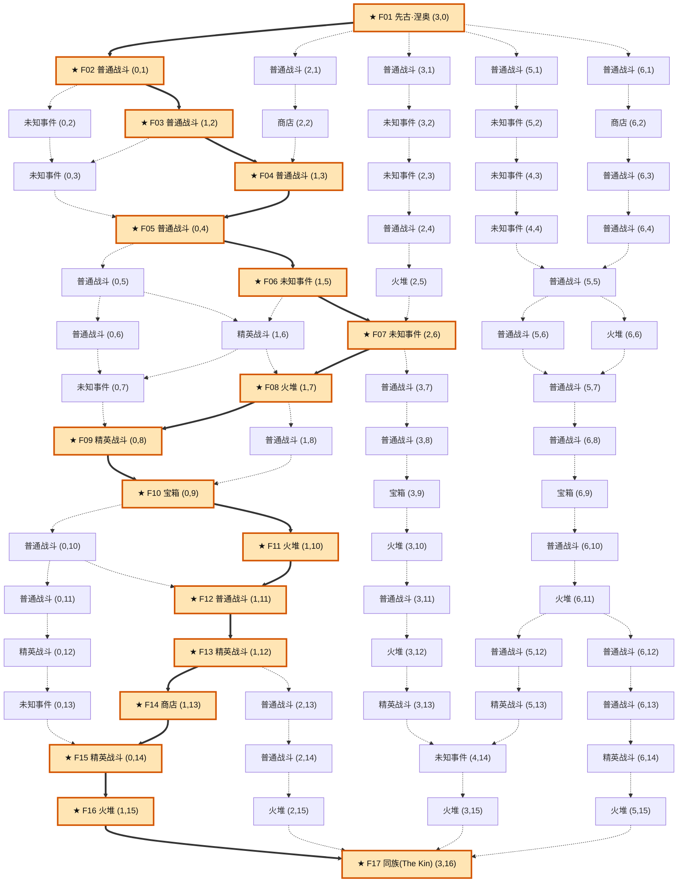
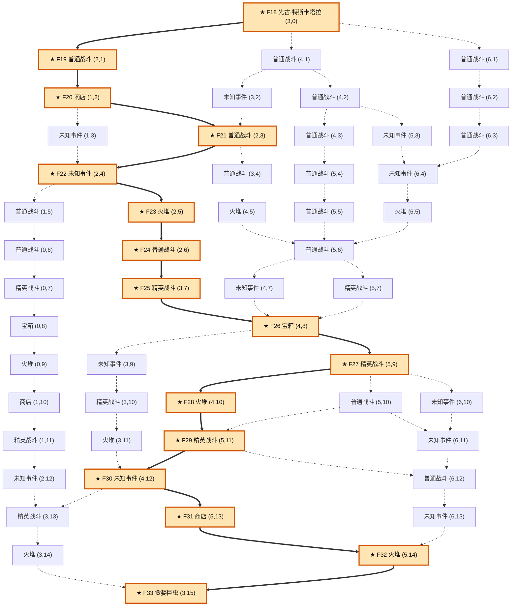
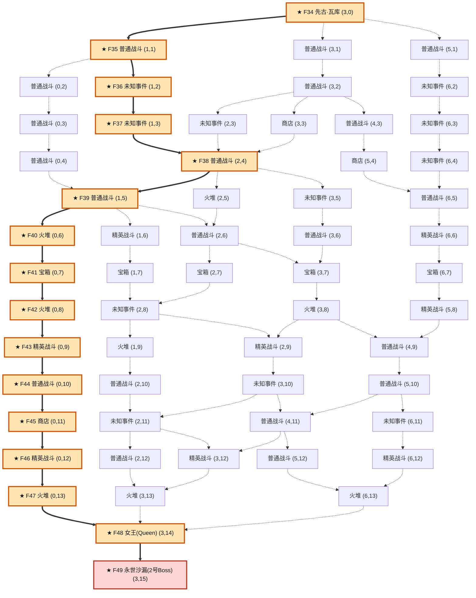

# 愚者（Fool）进阶 10 纯净手动爬塔完整复盘｜种子 `E3EQEQ91QFXB`

> **诚实与无作弊声明**：本局严格禁用任何战斗求解器（`CombatSolver` 与 `RandomForeseer` 均已关闭）、不窥探牌堆顺序与未来掉落、零 SL、零重开；全程通过 `STS2AIAgent` 本地 HTTP 接口以真实人类视角思考出牌并保存 `steps.jsonl`（807 步）与官方 `.run` 战绩文件 `1795064290.run`。  
> **对局结论**：于第 3 幕双 Boss 第 1 战以 **86/87 血仅掉 1 血** 击败【女王（Queen）】，随后在 **第 49 层最终 Boss【永世沙漏（Aeonglass）】第 8 回合** 因药水栏位索引误判（第 0 格`再生药水`用完后，`复制药水`仍留在 `option_index=1`，误传 `option_index=0` 导致药水未饮用、未能双倍触发`啾 坚定`）惜败阵亡（差 1 点格挡/血量未能跨入 10 费全开的 T9 斩杀局）。

---

## 一、对局总览与最终构筑

| 项目 | 数值 / 内容 |
| --- | --- |
| **角色 / 进阶** | **愚者（Fool）**｜**进阶 10（Ascension 10）** |
| **随机种子 / 版本** | `E3EQEQ91QFXB`｜`v0.113.1` |
| **最终结果** | 止步于 **第 49 层**（第 3 幕 2 号 Boss【永世沙漏】战败，`0/87 HP`） |
| **最终金币 / 药水** | `48` 金币｜未用出的【复制药水】 |
| **核心成型流派** | **「全旋律过牌引擎（曲中意×2 + 哇 啾 叽+ + 啾 叽×2 + 叽 跳跃系） + 0 费终曲核爆 + 烫嘴可可/古茶具/灯笼/面包/冰淇淋 跨回合蓄能体系」** |
| **最终遗物（18 件）** | 【歌曲之弓】(F01)、【涅奥的苦痛】(F01)、【烦人机关盒】(F09)、【钢笔尖】(F10)、【小邮箱】(F13)、【冰淇淋】(F15)、【烫嘴可可】(F18)、【战纹涂料】(F22)、【梨子】(F25)、【古茶具套装】(F26)、【皇家枕头】(F27)、【招财异鱼】(F29)、【弹珠袋】(F31)、【宝石面具】(F34)、【灯笼】(F41)、【历石】(F43)、【面包】(F45)、【不安油灯】(F46) |
| **最终卡组（36 张）** | **能力（3）**：【曲中意】×2、【潜伏根系】〔迅速2〕 **旋律核心技能/攻击（11）**：【哇 啾 叽+】、【终曲+】、【啾 叽】×2、【哇 爆破】、【哇 战锤】、【叽 唱诵+】、【叽 休止符】、【叽 跳跃+】、【叽 跳跃】、【啾 就绪+】、【啾 坚定+】、【啾 坚定】、【啾 四肢】、【叽 长鞭+】、【叽 长鞭】 *(计入所有带哇/啾/叽前缀卡共 16 张)* **箭矢射击（6）**：【愚蠢射击】、【绽放射击】、【蹒跚射击+】、【蹒跚射击】、【快速射击】×2 **功能过牌/回收（2）**：【涅奥之怒】、【翻找+】 **基础/诅咒（9）**：【打击】×4、【防御+】×2、【防御】×2、【进阶之灾】 |

> 注：以上卡组与遗物总数均直接核对自战后 `.run` 档案（`36` 张牌、`18` 件遗物；上表按功能分组方便阅读）。

---

## 二、全程三幕完整路线图（含已选与未选全部分支）

> 图标说明：`★` 为本局实际踏足路线与双线粗箭头 `==>`；其余黑色圆角节点与虚线箭头 `-.->` 为同一张地图生成出的全部分支路径。红色末节点为第 49 层战败终点。

### 1. 第 1 幕《茂密丛林》完整分支网格与走线图（F01～F17）

- **第 1 幕路线抉择亮点**：
  1. **前 4 层连吃 `F02→F05` 四场战斗迅速凑齐【哇 战锤】+【潜伏根系】+【绽放射击】+【蹒跚射击】**：避开过早事件空转，把核心射击与扎穿联动快速抓齐。
  2. **F06（仅 21 血）果断绕开 `(1,6)` 抢精英陷阱**：先走 `F06(1,5)` 拿〔迅速2〕附魔，再避战走 `F07(2,6)` 泉水白拿【精密药水】，进 `F08(1,7)` 火堆回血后稳吃 **`F09`、`F13`、`F15` 三只精英**（并串联 `F11` 火堆、`F14` 商店删【打击】买【叽 跳跃】、`F16` 火堆），滚出【烦人机关盒】、【钢笔尖】、【小邮箱】、【冰淇淋】四大核心遗物！

### 2. 第 2 幕《巢穴》完整分支网格与走线图（F18～F33）

- **第 2 幕路线抉择亮点**：
  1. **F18 拿到【烫嘴可可】后第一时间进 `F20(1,2)` 商店消费 209 金**：一口气买下第 2 张【叽 跳跃】、第 2 张【叽 长鞭】和核心质变**第 2 张【曲中意】**，直接把 7 费首回合转化为永动过牌引擎。
  2. **精准规划「商店-三火堆-三精英-后期商店」全功能路线**：后半程通过 `F25`、`F27`、`F29` 连吃三只精英且每次夹带 `F28`、`F32` 火堆联动【皇家枕头】+【古茶具套装】+【小邮箱】，最终在 `F31` 巧妙先买 38 金的【啾 四肢】触发【招财异鱼】+15 金凑出 199 金，顺手把 190 金的【弹珠袋】一并买下！

### 3. 第 3 幕《荣耀》完整分支网格与走线图（F34～F49）

- **第 3 幕路线抉择亮点**：
  1. **开局 84 金币主动走左路 `(1,1)` 避开 `(3,3)`、`(5,4)` 过早商店**：先通过战斗和问号滚牌与金币，再在 `F39(1,5)` 关键分叉处选择**最左边缘线 `(0,6)` 火堆→`(0,7)` 宝箱→`(0,8)` 火堆→`(0,9)` 精英→`(0,10)` 战斗→`(0,11)` 后期商店→`(0,12)` 精英→`(0,13)` 火堆**。
  2. **三条收益同时拉满**：这套线虽比中路少 1 个精英，但换来 **3 个火堆**（先重铸【哇 啾 叽+】与【终曲+】，Boss 前再回满 87/87 血+小邮箱拿【复制药水】）与 **270 金币后期商店**（精准购入对本套牌相当于无副作用 Boss 遗物的【面包】与第 2 张【啾 叽】）。

---

## 三、愚者（Fool）机制深度教学与本局实战经验总结

### 1. 愚者核心四大机制（手把手入门）

1. **箭矢（Arrow）与【扎穿（Pinned / Stuck）】循环**
   - 愚者开局只有 **1 支箭矢**（`箭矢:[0:retrieved]`）。打出「发射一支箭矢」的攻击牌（如【愚蠢射击】、【绽放射击】、【蹒跚射击】、【快速射击】）后，箭矢会插在目标身上（目标获得【扎穿】，箭矢状态变为 `away`）。
   - **收回条件（二选一）**：① 累计对带有该箭矢的敌人再打出 **3 次攻击牌命中**；② **击杀该敌人**立刻收回箭矢。
   - **实战铁律**：
     - 【取箭神技】（每回合给的衍生 0 费攻击）只要让箭矢刚好在「第 3 击」松脱收回，就能白嫖 **+3 能量**！
     - 【啾 坚定】（有箭矢才叠两次格挡）必须**先收回箭矢再打出**，否则格挡直接减半；【绽放射击】等射击牌在无箭矢在手时千万别空挥，且绝不乱抓会「摧毁箭矢」的【寂灭】（F33 果断跳过）。

2. **三旋律联动引擎（哇 / 啾 / 叽 + 曲中意 + 终曲）**
   - 愚者的音符牌分为三大音色前缀：**哇（Wah）**、**啾（Cho）**、**叽（Ki）**。每集齐一种新旋律，不仅解锁条件牌特效：
     - **集齐任意 3 种旋律** → 6 费核弹【终曲+】（打 55）直接变为 **0 费**！
     - **拥有哇或啾** → 【叽 休止符】不仅下回合 +5 费，还能在本回合**保留全部手牌**；
     - **拥有哇或叽** → 2 费【啾 四肢】（5×2 格挡）直接变为 **0 费**；
     - **拥有啾或叽** → 【哇 爆破】从全体打 14 变为**全体命中两次（28 伤）**。
   - **核心发动机【曲中意】实测细节**：每当你获得 **尚未激活的新旋律** 时抽 1 张牌（2 层【曲中意】就是抽 2 张）。因此单卡集齐三旋律的【哇 啾 叽+】配合双【曲中意】可瞬间「一卡抽 8 张」，但**当三种旋律均已激活时再打同音色牌不会再次触发【曲中意】**——要借此控制出牌顺序，先把能用的 0 费/减费牌清空手牌位再开【哇 啾 叽+】，以免因 10 张手牌上限卡死抽牌。

3. **【拉伸】与【瞄准】的区别（千万别混！）**
   - **【拉伸】**（来自【潜伏根系】、`绽放射击`）＝ 一次性加强**你打出的下一张格挡牌**的数值，并在打出后消耗掉；遇到多段格挡牌【啾 四肢】（获得 5 格挡**两次**）或【啾 坚定+】（有箭矢格挡**两次**）时，每一段都能吃到【拉伸】，收益翻倍！而【啾 叽】能「重新获得花费的拉伸」，相当于白嫖一次加强后把【拉伸】还给你！
   - **【瞄准】**（来自【歌曲之弓】、【啾 就绪+】）＝ 专项提升**射击牌**伤害的攻击加成。

4. **【悲伤】保留污染与【宝石面具】配比控牌**
   - 【翻找+】（1 费抽 4）与【哀伤打击】生成的【悲伤】带有**保留**属性，若牌组里没有【狂喜】或消耗手段，【悲伤】会一直赖在手里占掉 10 张上限中的宝贵位置，务必算好手牌空位再开【翻找+】。
   - 第 3 幕拿到的【宝石面具】会从牌库里**随机拉一张能力牌在首回合 0 费上手**。本局刻意只保留 3 张高纯度能力牌（【曲中意】×2 + 附魔〔迅速2〕的【潜伏根系】），拒绝在 F45 商店买进【歌之道】稀释能力池，从而实现 **100% 首回合免费过牌启动**。

---

## 四、核心战斗逐回合拆解与 F49 终局复盘

### 1. 第 1 幕 F17 Boss《同族首领》：精算药水以 11/77 险胜（9 回合）
- **难点**：全卡组尚无【哇 爆破】与【终曲】，前 4 层曾硬吃【蛇行扼杀者】19 伤且第 1 幕拿了 3 只精英，进 Boss 时仅 `58/77` 血；且同族首领随从协同攻击每轮高达 28~33 伤。
- **关键决策**：
  - **T1**：直接喝下【癫狂之触】，把 2 费【曲中意】永久降为 **0 费** 并立即拍下，避免被首领节奏拖垮。
  - **T5**：面对 33 点爆发伤害，精准交出【固化药水】将 11 点格挡翻三倍至 33 盾零伤抗下，最终 9 回合以 `11/77` 险胜并斩获卡组灵魂金卡【终曲】。

### 2. 第 2 幕 F33 Boss《贪婪巨虫》：双曲中意永动机 + 仪式收官（6 回合）
- **进场配置**：`87/87` 满血，9 费开局（【烫嘴可可】+4、【古茶具套装】+2），带着【弹珠袋】全体易伤与【马萨雷斯的赠礼】（仪式）。
- **运营要点**：T1 直接喝【马萨雷斯的赠礼】叠加每回合力量，随后用【哇 啾 叽+】+【双曲中意】每轮滤空半副牌库，靠【叽 长鞭+】配合【冰淇淋】源源不断产费，6 回合轻松轰死 341 血巨虫（`50/87 HP`），跳掉会烧射击卡的【怒放】与毁箭矢的【寂灭】。

### 3. 第 3 幕 F43《三骑士》& F46《机甲骑士》：两个 2 回合零/低损速杀
- **F43《三骑士》精英（2 回合 `0` 伤）**：T1 借助【宝石面具】0 费【曲中意】+ 10 费开局，用【蹒跚射击+】触发【钢笔尖】一箭爆头 75 伤打残【连枷骑士】、再以【哇 战锤】收人头收回箭矢并用 0 费【终曲+】压低【幽灵骑士】；T2 面对【幽灵骑士】贴上的【恶咒（全手牌虚无）】，用【啾 四肢】叠出 78 盾并靠【终曲+】直接斩杀【幽灵骑士】解咒，再用【涅奥之怒】从弃牌堆捞回【蹒跚射击+】与【终曲+】收掉【魔法骑士】。
- **F46《机甲骑士》精英（2 回合 `12` 伤）**：面对 320 血 + 2 层【人工制品】的机甲骑士，T1 交【蹒跚射击】精准剥除双层人工制品并接 2 费【终曲+】+【叽 休止符】攒出下回合 9 费；T2 【涅奥之怒】捞回【蹒跚射击】+【终曲+】，【钢笔尖】翻倍配合【易伤】单发打出 **`164` 伤**直接带走 320 血精英！

### 4. 第 3 幕 1 号 Boss F48《女王（QUEEN_BOSS）》：仅损 1 血完美通关（7 回合）
- **机制拆解**：女王召唤 211 血【火炬头聚合体】并给我方套上永久【虚弱 / 脆弱 / 易伤 99】与【魂缚锁链（每回合只能打出 1 张带“魂缚”标记的牌）】。
- **关键处理**：
  - **T1**：拒绝把 0 费【终曲+】浪费在爪牙火炬头身上，82 伤直接轰在 419 血主 Boss 女王本体，再借【叽 跳跃】抽 2 并凑 24 格挡零伤过 T1。
  - **T3–T6 魂缚位分配**：每回合把唯一的「魂缚出牌权」精准留给【涅奥之怒】、【叽 长鞭+】、【叽 跳跃】或 0 费【终曲+】，绝不让手里的魂缚【打击】/【防御】锁死关键牌。T6 用【绽放射击】挂 18 拉伸后借【叽 唱诵+】找出 0 费【啾 四肢】叠满 53 格挡防住 48 点三连击。
  - **T7【历石】精准绝杀**：女王剩 71 血 + 10 盾。先打【蹒跚射击+】破盾挂 2 易伤，再打【哇 啾 叽+】与【哇 战锤】把女王压进 `40` 血，结束回合准时引爆**第 7 回合【历石】52 点 AOE**，在火炬头出手前直接终结战斗，**全程仅掉 1 血（86/87）带双药水迈入最终 Boss！**

### 5. 第 3 幕 2 号 Boss F49《永世沙漏（AEONGLASS_BOSS）》：T1–T8 博弈与阵亡复盘
- **Boss 机制**：535 血超高血量 + 2 层【人工制品】 + 每数回合获得护盾 + 【凋萎存在】（持续往牌库塞【凋萎】：回合末仍在手里造成 3/6/9 伤）。
- **前 7 回合稳健推进**：T1 靠【防御+】全防 26 攻；T2【啾 坚定+】+【哇 啾 叽+】+【啾 就绪+】叠至 45 盾，【快速射击】+【叽 跳跃+】+【钢笔尖】【涅奥之怒】把 Boss 压到 464 血；T5 在 32 攻 + 6 凋萎压力下叠满 44 格挡零伤压至 418 血；T7【钢笔尖】+【哇 爆破】打出 56 伤，喝下`slot 0` 的【再生药水】并交【蹒跚射击+】剥除 2 层【人工制品】，回合末【历石】再炸 52 伤将 Boss 压到 `286/535`。
- **致命失误（第 8 回合）**：
  - T8 开局我方手握 **12 能量**、`21/87` 血、`再生(4)`、`11` 格挡，面对 Boss `21×2=42` 攻 + 1 张【凋萎】9 伤（总计 51 伤）。
  - 通过【叽 跳跃+】→【叽 长鞭+】→【打击】收回箭矢后，再用【叽 唱诵+】精准找到【啾 坚定】（箭矢在手可得 `(6+3)×2=18` 盾；若用【复制药水】则为 `18+12=30` 盾，总计 `41` 盾仅掉 `10` 血 + 回合末`再生`+4 回至 `15/87`，完美进入已有 10 费+牌库剩 11 张含【终曲+】/【哇 啾 叽+】/【翻找+】的 T9）。
  - **真实翻车原因**：由于 T7 消耗掉了第 0 格的【再生药水】，而【复制药水】原本位于第 1 格（`slot 1`），游戏内部药水栏位不会自动前移（显示为 `None:复制药水`）。实际执行 `use_potion option_index=0` 时接口返回无效操作，随后批次脚本仍继续打出了未经复制的【啾 坚定】（仅叠到 29 格挡，不足以抗下 51 总伤），最终以 `0/87` 遗憾倒在第 49 层。
  - **教训**：① 无论在 API 还是手操里，多槽位道具消费后务必确认栏位索引再执行后续出牌批次，脚本/批处理遇关键药水步骤绝不能跨步骤连发；② 其实 T7 之前若干小伤口（如 T4 留 1 击少叠盾省能量时）也有更早喝下【再生药水】或利用【重复射击】配合【复制药水】抢血线的余地。

---

## 五、全 49 层逐层完整执行与决策理由（中文全译名）

> 以下所有楼层状态、伤害、回血、金币、抓牌/跳过、事件选项、遗物与药水均精确核对自 `1795064290.run` 与 `steps.jsonl`。

### 第 1 幕：《茂密丛林》（共 17 层）

- **F01｜先古之民**｜涅奥
  - **状态变化**：战后生命 `61/77`｜金币 `99`
  - **先古抉择**：**【已选】**【涅奥的苦痛】（获得【涅奥之怒】；放弃【寻龙尺】）
  - **为什么这样选**：【涅奥之怒】（1 费打 10、从弃牌堆捞至多 2 张牌并消耗）在第 1 幕前期抢节奏与中后期回收【哇 啾 叽+】/【终曲+】均属顶级卡，远胜需要走 4 个问号的【寻龙尺】。
- **F02｜普通战斗**｜小史莱姆群｜`3` 回合
  - **状态变化**：战后生命 `54/77`（承伤 `7`）｜金币 `108` (`+9`)
  - **选牌结果**：**【抓】**【哇 战锤】 / 【深度拉伸】 / 【召回】
  - **为什么这样选**：1 费打 9、对【扎穿】敌人翻倍打 18，完美衔接【愚蠢射击】并补足【哇】旋律。
- **F03｜普通战斗**｜绒毛虫｜`3` 回合
  - **状态变化**：战后生命 `53/77`（承伤 `1`）｜金币 `115` (`+7`)
  - **选牌结果**：**【抓】**【潜伏根系】 / 【深度拉伸】 / 【哀伤打击】
  - **为什么这样选**：【哀伤打击】塞的【悲伤】带保留极其卡手；【潜伏根系】每回合稳定 +3 【拉伸】让基础防御变 8 格挡，提升长线承伤能力。
- **F04｜普通战斗**｜啃咬虫（弱池）｜`3` 回合
  - **状态变化**：战后生命 `40/77`（承伤 `13`）｜金币 `129` (`+14`)
  - **选牌结果**：**【抓】**【绽放射击】 / 【翻找】 / 【叽 唱诵】
  - **为什么这样选**：前期亟需第 2 张发射牌配合【歌曲之弓】6 瞄准（首回合打 17 伤且回 17 拉伸），并更频繁挂【扎穿】触发【哇 战锤】。
- **F05｜普通战斗**｜蛇行扼杀者（强池）｜`6` 回合
  - **状态变化**：战后生命 `21/77`（承伤 `19`）｜金币 `143` (`+14`)
  - **药水掉落**：**【拿】**【固化药水】
  - **选牌结果**：**【抓】**【蹒跚射击】 / 【箭术】 / 【喜悦重拳】
  - **为什么这样选**：此时仅 21 血急需即战力减伤，【蹒跚射击】1 费发射 13 伤（首回合 19 伤）+ 1 虚弱 + 1 易伤 + 【扎穿】，保命与增伤兼得。
- **F06｜未知事件**｜自助指南
  - **状态变化**：生命 `21/77`｜金币 `143`
  - **事件抉择**：读完整本书 → 给【潜伏根系】附魔**〔迅速 2〕**（首次打出抽 2 张）
  - **为什么这样选**：消除【潜伏根系】1 费能力牌的过牌亏节奏问题，使其成为白嫖+2过牌的神级启动卡。
- **F07｜未知事件**｜泉水
  - **状态变化**：生命 `21/77`｜金币 `143`
  - **事件抉择**：装瓶 → 获得**【精密药水】**
  - **为什么这样选**：21 血不敢强接 `(1,6)` 精英选择安全绕路；填满第 2 格药水栏备战 `(0,8)` 精英，避免为沐浴塞入诅咒【愧疚】。
- **F08｜火堆休息处**
  - **状态变化**：战后生命 `44/77`（回血 `+23`）｜金币 `143`
  - **火堆操作**：休息
  - **为什么这样选**：回血至健康线 44/77 迎战第 9 层精英。
- **F09｜精英战斗**｜异蛙寄生虫｜`7` 回合
  - **状态变化**：战后生命 `25/77`（承伤 `19`）｜金币 `171` (`+28`)
  - **遗物掉落**：**【拿】**【烦人机关盒】
  - **选牌结果**：**【抓】**【哇 啾 叽】 / 【啾 就绪】 / 【啾 叽】
  - **为什么这样选**：核心金卡【哇 啾 叽】1 费攻防过牌一体并单卡同时激活全三种旋律，是整个构筑起飞的原点。
- **F10｜宝箱**
  - **状态变化**：生命 `25/77`｜金币 `204` (`+33`)
  - **遗物获取**：**【拿】**【钢笔尖】
  - **为什么这样选**：第 10 张攻击牌双倍伤害，与后续【终曲+】、【蹒跚射击+】、【哇 战锤】完美爆炸。
- **F11｜火堆休息处**
  - **状态变化**：战后生命 `48/77`（回血 `+23`）｜金币 `204`
  - **火堆操作**：休息
  - **为什么这样选**：稳健补血连吃 F13、F15 两只精英。
- **F12｜普通战斗**｜墨灵群｜`3` 回合
  - **状态变化**：战后生命 `45/77`（承伤 `3`）｜金币 `212` (`+8`)
  - **选牌结果**：**【抓】**【啾 就绪】 / 【暴力和弦】 / 【说笑】
  - **为什么这样选**：1 费 8 格挡 + 3 瞄准 + 【啾】旋律，兼顾防线与【歌曲之弓】二次加成。
- **F13｜精英战斗**｜旧日雕像｜`4` 回合
  - **状态变化**：战后生命 `37/77`（承伤 `8`）｜金币 `241` (`+29`)
  - **遗物掉落**：**【拿】**【小邮箱】
  - **选牌结果**：**【抓】**【啾 坚定】 / 【沉重射击】 / 【哇 战锤】
  - **为什么这样选**：已有 3 张射箭牌与足够攻击卡，急需 1 费双倍格挡兼【啾】旋律的【啾 坚定】夯实防线。
- **F14｜商店**
  - **状态变化**：生命 `37/77`｜金币 `90` (`-151`)
  - **商店购买**：**【买卡】**【叽 跳跃】(51G)；**【删牌】**移除 1 张【打击】(100G)
  - **为什么这样选**：【叽 跳跃】配合 3 张射击卡稳定过 2 张且补全【叽】旋律；同步移除基础【打击】压缩牌库。
- **F15｜精英战斗**｜多尼斯异鸟｜`2` 回合
  - **状态变化**：战后生命 `35/77`（承伤 `2`）｜金币 `122` (`+32`)
  - **遗物掉落**：**【拿】**【冰淇淋】
  - **选牌结果**：**【抓】**【曲中意】 / 【啾 就绪】 / 【翻找】
  - **为什么这样选**：2 回合近乎无伤收掉精英拿到神物【冰淇淋】，且刚好抓到灵魂引擎【曲中意】（每次获旋律抽 1 张），构筑彻底成型！
- **F16｜火堆休息处**
  - **状态变化**：战后生命 `58/77`（回血 `+23`）｜金币 `122`
  - **火堆操作**：休息（小邮箱触发送出【消亡粉末】与【癫狂之触】，丢弃【精密药水】换取**【癫狂之触】**）
  - **为什么这样选**：留足血本并把强力 0 费【癫狂之触】带进 Boss 战。
- **F17｜关底 Boss**｜同族首领（THE_KIN_BOSS）｜`9` 回合
  - **状态变化**：战后生命 `11/77`（承伤 `47`）｜金币 `197` (`+75`)
  - **本场消耗**：【癫狂之触】（0 费【曲中意】）、【固化药水】（T5 翻三倍至 33 盾）
  - **选牌结果**：**【抓】**【终曲】 / 【炫耀】 / 【倦怠】
  - **为什么这样选**：牌组已有单卡齐三旋律的【哇 啾 叽】，【终曲】（6 费打 40，三旋律下变 0 费）完美成为主力斩杀大核。

### 第 2 幕：《巢穴》（共 16 层）

- **F18｜先古之民**｜特斯卡塔拉
  - **状态变化**：战后生命 `63/77`（跨幕回复 `+52`）｜金币 `197`
  - **先古抉择**：**【已选】**【烫嘴可可】（每场第 1 回合 +4 能量）
  - **为什么这样选**：T1 变 7 费开局，配合【冰淇淋】跨回合蓄能和 2 费【曲中意】启动无敌。
- **F19｜普通战斗**｜挖掘虫｜`2` 回合
  - **状态变化**：战后生命 `62/77`（承伤 `1`）｜金币 `209` (`+12`)
  - **选牌结果**：**【抓】**【叽 长鞭】 / 【哀伤打击】 / 【哇 战锤】
  - **为什么这样选**：1 费打 5 下回合 +2 费且带【叽】旋律，与【冰淇淋】+【曲中意】产生无限能量雪球。
- **F20｜商店**
  - **状态变化**：生命 `62/77`｜金币 `12` (`-197`)
  - **商店购买**：**【买卡】**【叽 跳跃】(26G)、【叽 长鞭】(49G)、第 2 张【曲中意】(74G)；**【买药】**【格挡药水】(48G)
  - **为什么这样选**：超级大商店！74 金购入第 2 张【曲中意】开启双倍抽牌时代，再低价补齐第 2 张【叽 跳跃】与【叽 长鞭】。
- **F21｜普通战斗**｜偷窃草蜢｜`3` 回合
  - **状态变化**：战后生命 `48/77`（承伤 `14`）｜金币 `26` (`+14`)
  - **夺回卡牌**：【蹒跚射击】
  - **选牌结果**：**【抓】**【哇 爆破】 / 【曲中意】 / 【锯齿箭矢】
  - **为什么这样选**：当时急缺群体 AOE（且 2 张【曲中意】已够用），【哇 爆破】在有啾/叽下全体打 28 并提供【哇】旋律。
- **F22｜未知事件**｜神秘宝箱
  - **状态变化**：生命 `48/77`｜金币 `60` (`+34`)
  - **遗物获取**：**【拿】**【战纹涂料】（随机升级 2 张技能牌：【啾 就绪+】、【防御+】）
- **F23｜火堆休息处**
  - **状态变化**：生命 `48/77`｜金币 `60`
  - **火堆操作**：锻造升级 **【哇 啾 叽】→【哇 啾 叽+】**
  - **为什么这样选**：1 费多抽 1 张（1→2）且加伤加盾（9→12），在双【曲中意】体系中为质变强化。
- **F24｜普通战斗**｜棘刺蟾蜍｜`3` 回合
  - **状态变化**：战后生命 `30/77`（承伤 `18`）｜金币 `75` (`+15`)
  - **选牌结果**：【说笑】 / 【持弓猛击】 / 【深度拉伸】 → **【跳过】**
  - **为什么这样选**：三张卡均不如已有抽牌与旋律组件，保持 26 张高密度。
- **F25｜精英战斗**｜残杀千足虫×3｜`3` 回合
  - **状态变化**：战后生命 `36/87`（承伤 `4`，【梨子】+10 上限与回血）｜金币 `103` (`+28`)
  - **遗物 / 药水**：**【拿】**【梨子】、**【拿】**【肌肉药水】
  - **选牌结果**：**【抓】**【啾 坚定】 / 【说笑】 / 【哇 爆破】
  - **为什么这样选**：补高质 1 费双倍盾与【啾】旋律浓度，稳固低血线防守端。
- **F26｜宝箱**
  - **状态变化**：生命 `36/87`｜金币 `135` (`+32`)
  - **遗物获取**：**【拿】**【古茶具套装】（休息后下战首回合 +2 能量）
- **F27｜精英战斗**｜蜂群术士｜`4` 回合
  - **状态变化**：战后生命 `36/87`（承伤 `0`）｜金币 `165` (`+30`)
  - **本场消耗**：【肌肉药水】、【格挡药水】（预知下一层火堆可用小邮箱补满）
  - **遗物 / 药水**：**【拿】**【皇家枕头】、**【拿】**【痊愈药水】
  - **选牌结果**：**【抓】**【叽 休止符】 / 【叽 长鞭+】 / 【哀伤打击】
  - **为什么这样选**：【叽 休止符】下回合 +5 费并在有哇/啾下保留全手牌，配合【冰淇淋】实现超大回合无缝接力。
- **F28｜火堆休息处**
  - **状态变化**：战后生命 `77/87`（回血 `+41`，皇家枕头生效）｜金币 `165`
  - **火堆操作**：休息（触发【古茶具套装】下战 +2 费、触发【小邮箱】收下**【技能药水】**）
- **F29｜精英战斗**｜感染棱柱｜`3` 回合
  - **状态变化**：战后生命 `58/87`（承伤 `19`）｜金币 `207` (`+42`)
  - **遗物掉落**：**【拿】**【招财异鱼】（每加入 1 张牌获得 15 金币）
  - **选牌结果**：**【抓】**【快速射击+】 / 【呼哨箭矢+】 / 【韵律打击】
  - **为什么这样选**：0 费升级射击打 13（首回合 19）并立刻触发【招财异鱼】+15 金币，零费启动【扎穿】体系。
- **F30｜未知事件**｜脑蛭
  - **状态变化**：生命 `58/87`｜金币 `222` (`+15`)
  - **事件抉择**：分享知识 5 选 1 → **【抓】**【快速射击】 / 【绷紧】 / 【搭箭】 / 【叽 跳跃】 / 【毒液】
  - **为什么这样选**：0 费发射免费打 10+扎穿，再吃【招财异鱼】+15 金把存款凑到 222 金迎战第 31 层商店。
- **F31｜商店**
  - **状态变化**：生命 `58/87`｜金币 `9` (`+15, -228`)
  - **商店购买**：**【买卡】**【啾 四肢】(38G)；**【买遗物】**【弹珠袋】(190G)
  - **为什么这样选**：精算【招财异鱼】机制：222 金买不起 190+38，但先买 38G 的【啾 四肢】触发异鱼 +15 金使现金变为 199G，恰好能再买下【弹珠袋】（全员开局易伤），一举两得！
- **F32｜火堆休息处**
  - **状态变化**：战后生命 `87/87`（回血 `+29`）｜金币 `9`
  - **火堆操作**：休息（弃【痊愈药水】换取小邮箱送的**【马萨雷斯的赠礼】**并触发【古茶具套装】）
- **F33｜关底 Boss**｜贪婪巨虫（THE_INSATIABLE_BOSS）｜`6` 回合
  - **状态变化**：战后生命 `50/87`（承伤 `37`）｜金币 `84` (`+75`)
  - **本场消耗**：【马萨雷斯的赠礼】（仪式每回合叠力）
  - **选牌结果**：【怒放】 / 【寂灭】 / 【狂喜】 → **【跳过】**
  - **为什么这样选**：【怒放】烧掉功能射击卡、【寂灭】摧毁唯一箭矢、【狂喜】仅当有大量悲伤时有效，全部果断跳过。

### 第 3 幕：《荣耀》（共 16 层）

- **F34｜先古之民**｜瓦库
  - **状态变化**：战后生命 `79/87`（跨幕回复 `+29`）｜金币 `84`
  - **先古抉择**：**【已选】**【宝石面具】（开局抽 1 张能力牌免费打出；放弃【小提琴】、【腌制活雾】）
  - **为什么这样选**：【小提琴】禁止回合内抽牌会直接废掉【曲中意】核心发动机；【宝石面具】100% 抓到【曲中意】或〔迅速2〕【潜伏根系】，首回合无损起飞。
- **F35｜普通战斗**｜虔诚雕刻师｜`1` 回合
  - **状态变化**：战后生命 `79/87`（承伤 `0`）｜金币 `114` (`+30`)
  - **选牌结果**：**【抓】**【翻找+】 / 【苦闷】 / 【啾 坚定】
  - **为什么这样选**：T1 无伤秒杀；1 费抽 4 张配合高启动能量极大拓宽过牌深度，招财异鱼+15 金。
- **F36｜未知事件**｜镜中倒影
  - **状态变化**：生命 `79/87`｜金币 `114`
  - **事件抉择**：触碰镜子（随机降级 2 张、升级 4 张：降级【哇 啾 叽】与【快速射击】，升级【叽 跳跃+】、【防御+】、【啾 坚定+】、【叽 长鞭+】）
  - **为什么这样选**：此时仅 5 张已升级牌而有 25+ 张未升级牌，预期净赚 +2 次强化，远好于翻倍成 65 张加诅咒【霉运】。
- **F37｜未知事件（遭遇战斗）**｜咬人卷轴×3｜`1` 回合
  - **状态变化**：战后生命 `79/87`（承伤 `0`）｜金币 `143` (`+29`)
  - **药水掉落**：**【拿】**【无色药水】
  - **选牌结果**：**【抓】**【啾 叽】 / 【深度拉伸】 / 【苦闷】
  - **为什么这样选**：T1【叽 长鞭】+【哇 爆破】双段全清零伤！抓住第 1 张双旋律卡【啾 叽】，单卡在双曲中意下可抽 4 张并降终曲 4 费，异鱼+15 金。
- **F38｜普通战斗**｜史莱姆狂战士｜`4` 回合
  - **状态变化**：战后生命 `73/87`（承伤 `6`）｜金币 `169` (`+26`)
  - **药水置换**：丢弃【技能药水】换取**【精炼混沌】**
  - **选牌结果**：**【抓】**【蹒跚射击+】 / 【绷紧+】 / 【沉重射击】
  - **为什么这样选**：已升好级的【蹒跚射击+】能提供 2 回合虚弱与易伤，完美衔接第 1 回合【弹珠袋】结束后的 Boss 战增伤与保血，异鱼+15 金。
- **F39｜普通战斗**｜构装体三人组｜`2` 回合
  - **状态变化**：战后生命 `73/87`（承伤 `0`）｜金币 `183` (`+14`)
  - **选牌结果**：【沉重射击】 / 【大树将倾+】 / 【生长】 → **【跳过】**
  - **为什么这样选**：2 回合零伤全清，三选一均不能强化现有旋律引擎，果断跳过不稀释。
- **F40｜火堆休息处**
  - **状态变化**：生命 `73/87`｜金币 `183`
  - **火堆操作**：锻造升级 **【哇 啾 叽】→【哇 啾 叽+】**
  - **为什么这样选**：第一时间把在 F36 被镜子降级的灵魂金卡重新升金（抽 1→抽 2）。
- **F41｜宝箱**
  - **状态变化**：生命 `73/87`｜金币 `220` (`+37`)
  - **遗物获取**：**【拿】**【灯笼】
- **F42｜火堆休息处**
  - **状态变化**：生命 `73/87`｜金币 `220`
  - **火堆操作**：锻造升级 **【终曲】→【终曲+】**（40 伤升至 55 伤）
- **F43｜精英战斗**｜三骑士（连枷骑士、幽灵骑士、魔法骑士）｜`2` 回合
  - **状态变化**：战后生命 `73/87`（承伤 `0`）｜金币 `248` (`+28`)
  - **遗物掉落**：**【拿】**【历石】
  - **选牌结果**：【哀伤打击】 / 【持弓猛击】 / 【啾 坚定】 → **【跳过】**
- **F44｜普通战斗**｜青蛙骑士｜`3` 回合
  - **状态变化**：战后生命 `65/87`（承伤 `8`）｜金币 `270` (`+22`)
  - **选牌结果**：**【抓】**【叽 唱诵+】 / 【活跃气氛】 / 【持弓猛击+】
  - **为什么这样选**：1 费看 4 拿 1 弃 3 且带【叽】旋律，可滤掉【打击】/【进阶之灾】并多吃 15 金刚好凑 270 金逛 F45 大店。
- **F45｜商店**
  - **状态变化**：生命 `65/87`｜金币 `21` (`+15, -264`)
  - **商店购买**：**【买遗物】**【面包】(192G)；**【买卡】**第 2 张【啾 叽】(72G)
  - **为什么这样选**：手握【烫嘴可可】+【灯笼】+【古茶具】首回合已有 8~10 费，买【面包】只减首回合 2 费就能换取 T2 起每回合常驻 +1 费的 Boss 级收益；72 金顺手买下第 2 张双旋律【啾 叽】（不稀释【宝石面具】且触发异鱼回 15 金）。
- **F46｜精英战斗**｜机甲骑士｜`2` 回合
  - **状态变化**：战后生命 `53/87`（承伤 `12`）｜金币 `48` (`+27`)
  - **遗物 / 药水**：**【拿】**【不安油灯】；丢【无色药水】换**【再生药水】**
  - **选牌结果**：【绷紧】 / 【曲中意】 / 【啾 四肢】 → **【跳过】**（避免第 3 张 2 费能力卡手）
- **F47｜火堆休息处**
  - **状态变化**：战后生命 `87/87`（回血 `+34`）｜金币 `48`
  - **火堆操作**：休息（回满 87/87 + 激活【古茶具】+ 小邮箱补【复制药水】与【速度药水】，舍弃随机【精炼混沌】换高上限**【复制药水】**）
- **F48｜1 号 Boss**｜女王（QUEEN_BOSS）｜`7` 回合
  - **状态变化**：战后生命 `86/87`（承伤 `1`）｜金币 `48`
  - **战况总结**：零药水消耗，7 回合仅掉 1 血由【历石】52 点 AOE 斩杀女王通关。
- **F49｜2 号 Boss（最终战）**｜永世沙漏（AEONGLASS_BOSS）｜`8` 回合
  - **状态变化**：战后生命 `0/87`（承伤 `95` / 再生回血 `9`）｜金币 `48`
  - **遗憾谢幕**：T7 饮用【再生药水】并轰掉 2 层人工制品且触发【历石】压 Boss 至 286 血；T8 因误用 `option_index=0` 未能成功喝下留在 1 号槽的【复制药水】，格挡少 12 点而遗憾以 `0/87` 阵亡。
