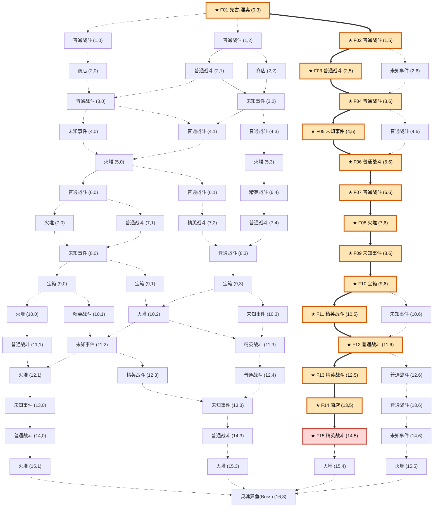

# 铁甲战士（Ironclad）恐惧模式（Dread）完整复盘｜种子 `40E1D5UW1LXV`

> **诚实与无作弊声明**：本局严格禁用任何战斗求解器（`CombatSolver` 与 `RandomForeseer` 均未加载）、零 SL、零重开；全程通过 `STS2AIAgent` 本地 HTTP 接口以真实人类视角出牌，保存 `steps.jsonl` 与官方 `.run` 战绩文件 `1795075720.run`。  
> **对局结论**：本局挑战**恐惧模式（`dread`）**（所有进阶 10 调整启用 + 第 1 幕【灵魂异鱼】支配每场战斗往抽牌堆洗入 1 张`1费/不打回合末掉6血`的【呼唤】）。采用「20~30 张精简循环小卡组（【与我一战！】+【头槌】+【战鼓】+【战斗专注】+【耸肩无视】×2 + 0 费【万向斩】/【黯淡匕首】）」策略，接连零药水拿下 `F11 骇鳗`、`F13 鬼祟珊瑚群`，但因 F13 战后仅剩 `9/80` 血走入无避战出口的 `F14 商店 → F15 强制第 3 只精英` 路线，在面对 `F15 花园幽灵鳗×4` 时因【应急按钮】2 回合禁止格挡副作用及 T2 抽到 `2` 费【呼唤】，惜败于第 15 层（`0/80 HP`）。

---

## 一、对局总览与核心构筑

| 项目 | 数值 / 内容 |
| --- | --- |
| **角色 / 模式** | **铁甲战士（Ironclad）**｜**恐惧模式（`dread`，启用全部进阶 10 规则）** |
| **随机种子 / 版本** | `40E1D5UW1LXV`｜`v0.113.1` |
| **Act 1 支配 Boss** | 【灵魂异鱼（SOUL_FYSH_BOSS）】——支配效果：**每场战斗开始在抽牌堆洗入 1 张【呼唤】（手牌结束回合扣 6 血）** |
| **最终结果** | 止步于 **第 15 层**（第 3 只精英【花园幽灵鳗 × 4】战败，`0/80 HP`） |
| **最终金币 / 药水** | `8` 金币｜未用的【敏捷药水】（`slot1`） |
| **最终遗物（6 件）** | 【燃烧之血】(F01)、【小型扭蛋】(F01)、【招架盾】(F01 开出)、【意外光滑的石头】(F10)、【白兽雕像】(F11)、【赤牛】(F13) |
| **最终卡组（23 张）** | **核心成长与反复启动（4）**：【与我一战！】(+3力)、【头槌】(置顶Key牌)、【战鼓】(抽2/被消耗+2费)、【战斗专注】(0费抽3) **0 费与功能输出（4）**：【万向斩】(0费全伤8)、【黯淡匕首】(0费7伤)、【闪电霹雳】(1费AOE+易伤)、【熔融之拳】(1费10伤+易伤翻倍/消耗) **防守与减薄（4）**：【耸肩无视】×2(抽1+9盾)、【坚毅】(8盾+消耗1)、【应急按钮】(0费30盾/消耗) **基础 / 诅咒（11）**：【打击】×5、【防御】×4、【痛击】、【进阶之灾】 |

---

## 二、第 1 幕完整分支路线图与路线失误深度复盘

### 为什么不走其他路线 & 真正导致 F15 死亡的“单行道陷阱”
1. **前期路线（完美）**：放弃 `(1,0)`（F03 早商店太穷）与 `(1,2)`（整幕中后段彻底没商店），走右侧 `(1,5)` 连战拿组件并在 `F05(4,5)` 用事件避战拿 0 费【黯淡匕首】；随后靠 `F09` 问号意外开出的商店拿到【万向斩】+【战鼓】，顺利吃掉 `F11`、`F13` 两只精英拿到【白兽雕像】+【赤牛】。
2. **致命路线失误（F13 分叉点 `(12,5)` vs `(12,6)`）**：
   - 打完 `F12(11,6)` 后，我方仅剩 **`8/80` 血**。此时选择了 `(12,5)` 精英想拿遗物顺便进 `(13,5)` 商店，**却忽视了一点：在地图拓扑上，`(12,5) → (13,5)商店 → (14,5)精英` 是一条没有任何退路的单行道！**
   - 因为 F13（`鬼祟珊瑚群`，硬化外壳强行拖满 5 回合）耗光了【鲜血药水】和【能力药水】，战后只有 `9/80` 血且**进 `(13,5)` 商店时只有 `141G`，买不到任何回血遗物/药水**，随后被系统强制推入无火堆前置的 `F15(14,5)` 第 3 只精英（【花园幽灵鳗×4】），即便靠商店买的【应急按钮】保过 T1，T2 在 `不可格挡` + 抽到 `2` 费【呼唤】下无力回天。
   - **正确高水温决策复盘**：面对恐惧模式第 1 幕仅 1 个中间火堆 `(7,6)` 的地形，打完 F12 剩 `8/80` 血且手里已有【白兽雕像】+ 5 件遗物时，**`F13` 完全不该去赌单行道 `(12,5)` 精英，而应该果断折向右侧 `(12,6) 普通战 → (13,6) 普通战 → (14,6) 未知事件 → (15,5) 火堆`**——既可用【白兽雕像】和【燃烧之血】把血线稳步养回来，还能保住两条命走进 `F16` 火堆见 Boss！

---

## 三、本局抓牌核心教训：即时战力、战未来与 Boss/精英针对

| 楼层 | 当时选项与局势 | 我方选择与逻辑 | 复盘评估（即时战力 vs 战未来） |
| --- | --- | --- | --- |
| **F02** | 【熔融之拳】/【挑衅】/【余烬】 | 抓**【熔融之拳】** | ✅ 极优：1费10伤提供即战力且自带消耗，绝不稀释小卡组，还配合痛击易伤翻倍 |
| **F03** | 【双重打击】/【撕裂】/【闪电霹雳】 | 抓**【闪电霹雳】** | ✅ 极优：拒绝“0即时战力的空头未来牌【撕裂】”，靠【闪电霹雳】1费AOE+易伤轻松打穿 F04 双蛞蝓与 F06 三尾鼠 |
| **F04** | 【与我一战！】/【岩石铠甲】/【巨像】 | 抓**【与我一战！】** | ⚖️ 战略抉择：拿到急需的力量成长（后续秒杀 F11 骇鳗与 F12 幽灵船的关键）；但【岩石铠甲】(1费4覆甲=10总盾+联动招架盾)在 F07–F15 能极大幅度保血，高水温下若已缺盾，覆甲有时比“给敌+1力”的【与我一战！】更稳健 |
| **F06** | 【战斗专注】/【上勾拳】/【惊逃】 | 抓**【战斗专注】** | ✅ 极优：0 费抽 3 是小卡组反复抽到【与我一战！】/【万向斩】的超级发动机 |
| **F07** | 【余烬】/【头槌】/【坚毅】 | 抓**【坚毅】** | ✅ 合理：补盾并多次在实战中烧掉多余【打击】；但若当时拿到【头槌】就能更早反复打 Key 牌 |
| **F09 商店** | 151G：买【万向斩】+【战鼓】 vs 删打击 | 买**【万向斩】+【战鼓】** | ✅ 极优：0费万向斩直接成为本局最强清杂核，半价38G战鼓完美补过牌 |
| **F11 / F12** | 先后面对【残酷】、【暴走】、【巨像】 | 抓两张**【耸肩无视】** | ✅ 极优：1费9盾(意外光滑的石头)+抽1不稀释小卡组，直接帮我方在 F12 以 `2/80` 极限省下【鲜血药水】拿下胜利 |
| **F13** | 【头槌】/【战斗专注】#2/【上勾拳】 | 抓**【头槌】** | ✅ 极优：避免两张【战斗专注】同回合卡死，补上反复打出 Key 牌的最后拼图 |
| **F14 商店** | 9/80血 141G 强制面对 F15 精英 | 买【应急按钮】+【敏捷药水】 | ⚠️ 根源在 F13 走错路线：进入 F15 9血无解局，【应急按钮】救了 T1 却在多怪精英 T2 因“2回合不可格挡”把自身锁死；此时买【虚弱药水】+【敏捷药水】也扛不住 T1 15 伤 |

---

## 四、本局回合均伤害（DPT）实测统计表

| 楼层 / 敌人 | 总基础血量 | 实测回合数 | 实测本体净 DPT | 战损（含呼唤/燃烧之血后净变） |
| --- | --- | --- | --- | --- |
| `F02` 海洋混混 | `48`（另有8盾） | `5` 回合 | `9.60`/回合 | 承伤 `11` / 战后 `59/80` (`-5`) |
| `F03` 淤泥旋螺 | `41` | `4` 回合 | `10.25`/回合 | 承伤 `12` / 战后 `53/80` (`-6`) |
| `F04` 噬尸蛞蝓×2 | `28+27=55` | `4` 回合 | `13.75`/回合 | 承伤 `17` / 战后 `42/80` (`-11`) |
| `F06` 双尾鼠×3 | `18+19+21=58` | `3` 回合 | `19.33`/回合 | 承伤 `7` / 战后 `41/80` (`-1`) |
| `F07` 化石追踪者 | `55` | `3` 回合 | `18.33`/回合 | 承伤 `32` / 战后 `15/80` (`-26`) |
| `F11` 骇鳗（精英） | `150` | `6` 回合 | **`25.00`/回合** | 承伤 `32` / 战后 `13/80` (`-2`) |
| `F12` 幽灵船 | `67` | `5` 回合 | `13.40`/回合 | 承伤 `11` / 战后 `8/80` (`-5`) |
| `F13` 鬼祟珊瑚群（精英） | `80`（硬化外壳20上限） | `5` 回合 | `16.00`/回合（封顶上限） | 承伤 `21` / 喝鲜血药 / 战后 `9/80` |
| `F15` 花园幽灵鳗×4（精英） | `28+30+27+31=116` | `2` 回合 | —（T1 全体破盾压 [2] 至 8 血） | T2 不可格挡下 `0/80` 战败 |

> **关键观察**：恐惧模式下每战强行塞入的【呼唤】实质上等于每圈变相抽走 `1` 点能量或造成 `6` 点真实伤害；F07 掉血 `32` 与 F13 的 5 回合硬消耗，直接暴露出第 1 幕没有及时在商店删掉多余【打击】、以及仅在 F08 经过 `1` 个火堆时贪心连踩第 3 只单行道精英的风险。

---

## 五、全 15 层逐层操作与日志简表

- **F01｜涅奥**：选【小型扭蛋】开出**【招架盾】**（回合末达指定格挡对随机敌人造成 6 伤）。
- **F02｜海洋混混 (`5T`)**：善用【防御×2】稳定触发【招架盾】，`59/80` 抓**【熔融之拳】**。
- **F03｜淤泥旋螺 (`4T`)**：`53/80` 抓**【闪电霹雳】**解决多怪 AOE 与 1 费易伤。
- **F04｜噬尸蛞蝓×2 (`4T`)**：T2 精准先秒 1 只触发【饥饿】击晕另一只躲过 15 伤，掉【鲜血药水】并抓**【与我一战！】** (`42/80`)。
- **F05｜明显有秘密的瀑布**：选温柔以待拿 `0` 费**【黯淡匕首】**，拒绝双【愧疚】污染牌库。
- **F06｜双尾鼠×3 (`3T`)**：T1【闪电霹雳】全员易伤秒 1 只，T2【黯淡匕首】+【痛击】秒第 2 只，几乎无伤（`41/80`）抓**【战斗专注】**。
- **F07｜化石追踪者 (`3T`)**：T2 先【战斗专注】过牌，用【痛击】+【黯淡匕首】+【熔融之拳】压进 9 血 4 层易伤，T3 斩杀拿**【坚毅】** (`15/80`)。
- **F08｜火堆**：休息回 24 血至 `39/80`。
- **F09｜问号商店**：`151G` 买进 `82G` 0 费**【万向斩】** + `38G` 半价**【战鼓】**，留钱进后半程。
- **F10｜宝箱**：拿到**【意外光滑的石头】**（+1 敏捷，双防御直接稳定达 12 盾触发招架盾）。
- **F11｜骇鳗 (`6T`)**：T4【痛击】+【万向斩】+【打击】打 `40` 伤精准跨过 75 血【尖叫】击晕线省 15 伤，零药水 6 回合斩杀夺得**【白兽雕像】**，抓**【耸肩无视】** (`13/80`)。
- **F12｜幽灵船 (`5T`)**：T2 后手【坚毅】精准烧掉废【打击】，T4 留 `2/80` 血挂易伤，T5【与我一战！】+【打击】零药水斩杀，白兽掉【能力药水】，再抓第 2 张**【耸肩无视】** (`8/80`)。
- **F13｜鬼祟珊瑚群 (`5T`)**：T1 喝【鲜血药水】+【能力药水】开出**【薪火之源】**，每回合 4 费稳打满【硬化外壳(20)】上限夺得**【赤牛】**并掉【异蛇之油】，抓**【头槌】** (`9/80`)。
- **F14｜商店**：无退路进强制精英，购【应急按钮】(`83G`) + 【敏捷药水】(`50G`)。
- **F15｜花园幽灵鳗×4 (`2T`)**：T1【应急按钮】+【赤牛】【闪电霹雳】全员破盾压血线，T2 受限于 `不可格挡(1)` 及抽到 `2` 费【呼唤】，惜败结算（`0/80`）。
